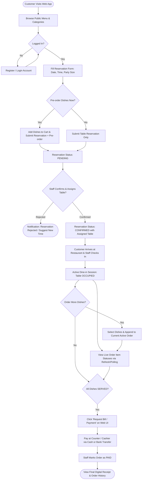
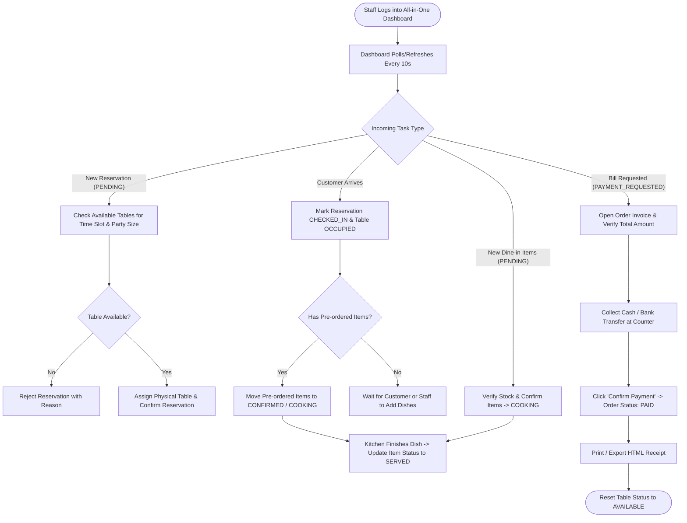
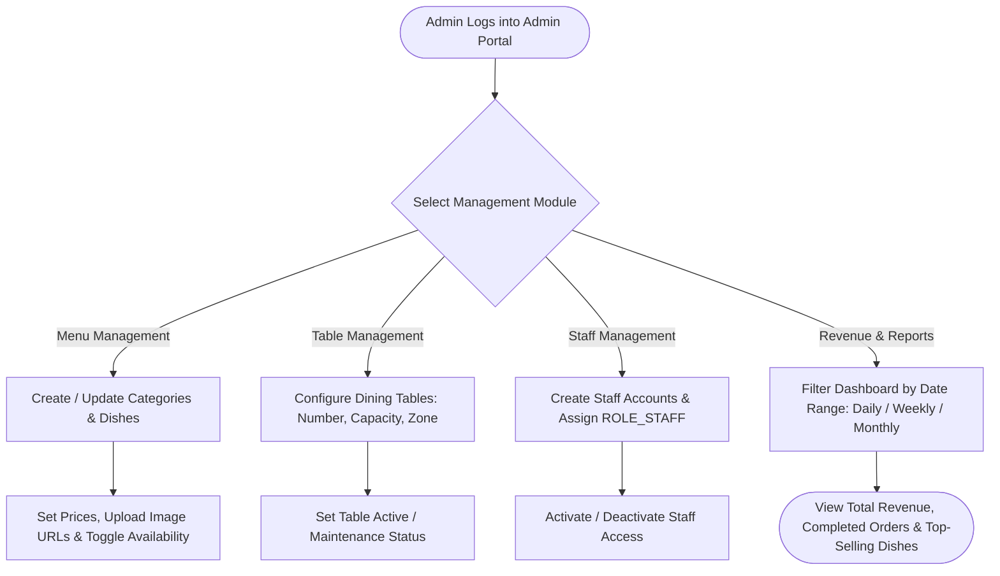
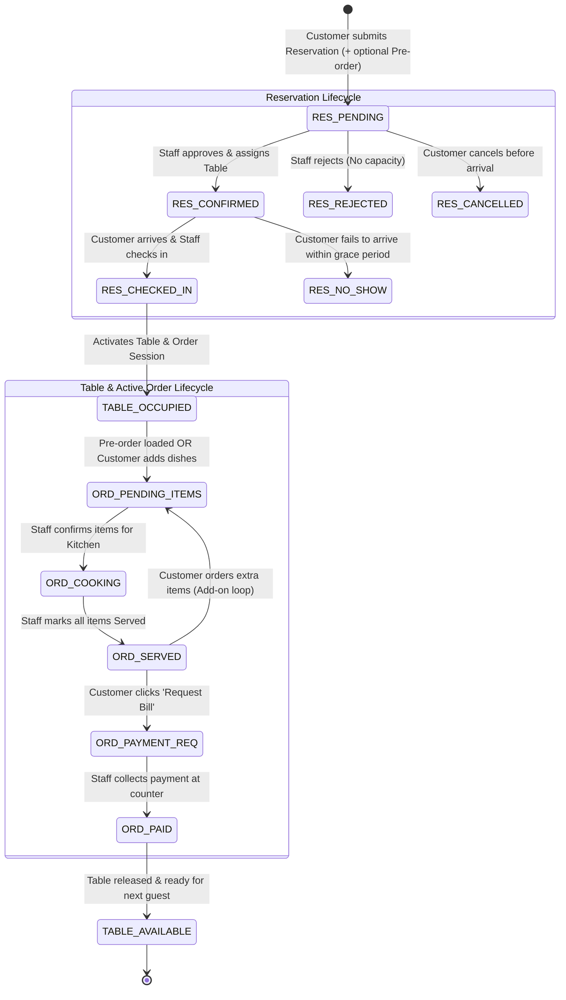

# Product Requirements Document (PRD) & Agile Specification
**Project Title:** Basic Restaurant Management Web Application  
**Course:** Web Application Development (University Capstone Project)  
**Team Size & Timeline:** 3 Students | 4 Weeks  
**Technology Stack:** Java 17+, Spring Boot 3.x (Spring MVC / J2EE), JSP & JSTL, MySQL 8.0, Apache Maven, Apache Tomcat 10.x  

## 1. Product Requirements Document (PRD Overview)

### 1.1. Project Overview

#### A. Problem Statement
Small-to-medium casual dining restaurants frequently rely on manual paper tickets, verbal communication, or disconnected spreadsheets to handle table reservations, dine-in ordering, kitchen coordination, and billing. This manual workflow leads to:
* **Double-booked or mismanaged tables** during peak dining hours due to lack of centralized reservation tracking.
* **Slow order fulfillment and miscommunication** between customers, waiters, and kitchen staff when taking pre-orders or add-on orders at the table.
* **Billing calculation errors and delayed table turnaround** when aggregating multiple ordering rounds into a single receipt.
* **Lack of real-time revenue visibility** for restaurant managers to track daily sales and top-selling dishes.

#### B. Product Objectives (SMART Goals for a 4-Week Capstone Project)
* **End-to-End Digital Workflow:** Digitize 100% of the core restaurant service loop—from **Account-based Online Reservation & Pre-ordering** to **Table Check-in**, **In-meal Add-on Ordering**, and **Counter Payment Settlement**.
* **Operational Centralization:** Provide a unified **All-in-One Staff Dashboard** that allows staff to manage reservations, table occupancy, dish preparation states, and billing from a single interface with light AJAX polling (5–10s refresh cycle).
* **Academic & Technical Feasibility:** Deliver a clean, maintainable **Spring Boot + JSP/JSTL + MySQL** monolithic web application within **4 weeks** by a **3-student development team**, adhering strictly to MVC architecture and relational database best practices.

#### C. System Scope
* **In-Scope (MVP):**
  * Role-based web portal supporting **Customer**, **Staff**, and **Admin** roles.
  * Public menu catalog with category filtering, keyword search, and stock availability status.
  * Customer account registration/login, online table booking, pre-ordering dishes, active dine-in order tracking, add-on ordering, and bill requesting.
  * Unified Staff workspace for reservation approval/table assignment, customer check-in, sequential order item status updates (`PENDING` -> `COOKING` -> `SERVED`), and counter checkout (`PAID`) with printable HTML receipts.
  * Admin back-office for Menu CRUD, Dining Table CRUD, Staff Account CRUD, and Revenue/Order Analytics.
* **Out-of-Scope (Non-Goals):**
  * Third-party online payment gateways (VNPay/Stripe webhooks).
  * Complex recipe-level raw ingredient inventory deduction.
  * Multi-branch franchise management or external delivery fleet integration.

### 1.2. User Personas & Role-Based Access Control (RBAC)

#### A. User Personas

| Persona | Role Code | Core Responsibilities & Goals | Pain Points Addressed |
| :--- | :--- | :--- | :--- |
| **Diner (Customer)** | `ROLE_CUSTOMER` | Browse the menu, book a table in advance, pre-order favorite dishes to save waiting time, order extra items while dining, and view transparent digital bills. | Long waiting times for food after arrival; uncertainty whether a table reservation is confirmed; lack of visibility into current bill total. |
| **Restaurant Operator (Waiter / Cashier / Kitchen)** | `ROLE_STAFF` | Triage reservations, assign physical tables, check in arriving guests, coordinate dish preparation statuses, and process counter payments quickly. | Switching between too many complex screens; losing track of add-on items ordered mid-meal; manual bill calculation mistakes. |
| **Restaurant Manager (Admin)** | `ROLE_ADMIN` | Configure menu items and pricing, manage physical table layouts, control staff accounts, and monitor daily/monthly revenue performance. | Inability to quickly mark sold-out dishes; lack of accurate historical sales reports. |

#### B. RBAC Permission Matrix

| System Resource / Action | Anonymous (Guest) | Customer (`ROLE_CUSTOMER`) | Staff (`ROLE_STAFF`) | Admin (`ROLE_ADMIN`) |
| :--- | :---: | :---: | :---: | :---: |
| View Public Menu & Dish Details | Read | Read | Read | Full CRUD |
| Register / Login / Manage Own Profile | Create / Read | Read / Update | Read / Update | Read / Update |
| Create Reservation & Pre-order Cart | Denied (Redirect) | Create / Read / Cancel | Read / Update Status | Read / Update Status |
| Assign Physical Table & Check-in Guest | Denied | Denied | Update | Read / Update |
| Append Dishes to Active Dine-in Order | Denied | Create (Own Order) | Create / Read / Update | Read |
| Update Dish Status (`PENDING` -> `COOKING` -> `SERVED`) | Denied | Read Only | Update | Read / Update |
| Request Bill (`PAYMENT_REQUESTED`) | Denied | Update (Own Order) | Update | Read |
| Confirm Counter Payment (`PAID`) & Print Invoice | Denied | Read (Own Invoice) | Update / Print | Read / Print |
| Manage Dining Tables (CRUD Layout & Capacity) | Denied | Denied | Read Status | Full CRUD |
| Manage Staff Accounts & View Revenue Analytics | Denied | Denied | Denied | Full CRUD / Read |

### 1.3. Core Functional Epics & Modules

* **EPIC-01: Authentication & User Account Module (`Auth & User`)** — Session-based authentication using Spring Security (or custom Auth Interceptor + BCrypt password hashing); customer self-registration, login/logout, personal profile editing, and booking/order history lookup.
* **EPIC-02: Digital Menu & Catalog Module (`Menu & Catalog`)** — Dynamic menu browsing categorized by food/beverage types, search by dish name, and real-time `Available` / `Out of Stock` badge rendering; Admin CRUD for categories and dishes + Staff quick stock toggle.
* **EPIC-03: Table Reservation & Pre-Order Module (`Reservation & Pre-Order`)** — Customer reservation booking form (Date, Time Slot, Guest Count, Special Notes) coupled with a session-backed Pre-order Shopping Cart; reservation validation and customer-initiated cancellation when still `PENDING`.
* **EPIC-04: Unified Staff Operations & Dine-in Order Module (`Staff Dashboard & Order Ops`)** — All-in-One Staff Dashboard displaying Table Status Grid (`AVAILABLE`, `RESERVED`, `OCCUPIED`) and Active Order Queue; Staff workflow to approve/reject `PENDING` reservations, assign `Table_ID`, execute Guest Check-in, append add-on dishes, and progress item statuses (`PENDING` -> `COOKING` -> `SERVED`).
* **EPIC-05: Billing, Counter Checkout & Receipt Module (`Billing & Payment`)** — Customer "Request Bill" trigger (`PAYMENT_REQUESTED`); counter checkout screen calculating subtotal and grand total; Staff confirmation of payment (`CASH` or `BANK_TRANSFER`), printable JSP invoice view, and automatic table release (`AVAILABLE`).
* **EPIC-06: Administration, Workforce & Revenue Analytics Module (`Admin & Reports`)** — Admin CRUD for Dining Tables and Staff Accounts; Analytics Dashboard featuring date-range filtering, Total Revenue KPI cards, Completed vs. Cancelled Order counts, and Top 5 Best-Selling Dishes chart.

### 1.4. Non-Functional Requirements (NFRs) & Technical Constraints

* **Architecture & Tech Stack Constraints:** Java 17+ with Spring Boot 3.x (Spring MVC, Spring Data JPA / Hibernate, Bean Validation); JSP & JSTL view layer styled with Bootstrap 5; MySQL 8.0 with InnoDB `@Transactional` integrity; Maven WAR deployment on Apache Tomcat 10.x.
* **Security Requirements:** BCrypt password encryption; strict server-side URL authorization (`HTTP 403 Forbidden` on unauthorized role access); customer session isolation ensuring customers only access their own reservations and active orders.
* **Performance & Real-Time Update Strategy:** Lightweight AJAX `GET` polling every 10 seconds plus manual `"Refresh Now"` triggers on the Staff Dashboard and Customer Active Order tracking view; standard page load and CRUD response times `< 1.5 seconds`.
* **UI/UX & Responsiveness:** Mobile-first responsive views (`375px–430px`) for Customer menu/ordering screens; Desktop/Tablet grid views (`1024px+`) for the All-in-One Staff Dashboard and Admin Analytics Portal.

## 2. MVP Feature Scope (MoSCoW Matrix) & User Flow Diagrams

### 2.1. Role-Based Feature Matrix (MoSCoW Prioritization)

| Module | Feature / Capability | Roles | Priority | Implementation Note (4-Week Scope) |
| :--- | :--- | :--- | :---: | :--- |
| **1. Auth & Profile** | Register, Login, Logout (Session-based) | Customer, Staff, Admin | **Must-have** | Spring Security / HttpSession with RBAC (`ROLE_CUSTOMER`, `ROLE_STAFF`, `ROLE_ADMIN`) |
| **1. Auth & Profile** | View & Update Personal Profile / Password | Customer, Staff, Admin | **Should-have** | Basic CRUD on user profile |
| **1. Auth & Profile** | Forgot Password via Email OTP | Customer | **Won't-have** | Skip SMTP integration to save time; Admin resets passwords if needed |
| **2. Menu & Catalog** | Browse Menu by Category, Search, Filter Available Items | Customer, Staff, Admin | **Must-have** | Publicly viewable; ordering requires Customer login |
| **2. Menu & Catalog** | Manage Categories & Menu Items (CRUD, Price, Image, Stock) | Admin | **Must-have** | Admin toggles `Available` / `Out of Stock` instantly |
| **2. Menu & Catalog** | Toggle Dish Availability (`Out of Stock`) during shift | Staff, Admin | **Should-have** | Prevents Customers from ordering sold-out items |
| **3. Table & Booking** | Book a Table Online (Date, Time Slot, Guest Count, Notes) | Customer | **Must-have** | Requires Customer login; creates Reservation in `RES_PENDING` state |
| **3. Table & Booking** | Pre-order Dishes during Table Reservation (Cart) | Customer | **Must-have** | Links pre-selected order items to the Reservation record |
| **3. Table & Booking** | Review, Confirm, or Reject Reservations & Assign Table | Staff, Admin | **Must-have** | Staff checks capacity and assigns a physical `Table_ID` |
| **3. Table & Booking** | Check-in Customer upon Arrival & Activate Dine-in Order | Staff | **Must-have** | Transitions Table to `OCCUPIED` and activates Dine-in Order |
| **3. Table & Booking** | CRUD Restaurant Tables (Number, Capacity, Zone) | Admin | **Must-have** | Admin configures physical table layout |
| **4. Dine-in & Kitchen** | Add Additional Dishes to Active Dine-in Order | Customer, Staff | **Must-have** | Logged-in Customer or Staff appends items to the active table order |
| **4. Dine-in & Kitchen** | All-in-One Staff Dashboard (Update Order & Item Status) | Staff | **Must-have** | Statuses: `PENDING` -> `COOKING` -> `SERVED` via AJAX Polling / Refresh |
| **4. Dine-in & Kitchen** | Cancel Uncooked Order Items | Customer, Staff | **Should-have** | Allowed only while item status is still `PENDING` |
| **5. Billing & Payment** | Request Bill / Checkout from Customer Web UI | Customer | **Must-have** | Flags active Order as `PAYMENT_REQUESTED` on Staff Dashboard |
| **5. Billing & Payment** | Counter Payment Confirmation (Cash / Static QR Transfer) | Staff | **Must-have** | Staff verifies payment, marks Order `PAID`, and releases Table to `AVAILABLE` |
| **5. Billing & Payment** | Generate Printable HTML/PDF Invoice Receipt | Customer, Staff, Admin | **Should-have** | Clean JSP invoice view with browser `window.print()` support |
| **5. Billing & Payment** | Automated Online Payment Gateway (VNPay / Stripe) | Customer | **Won't-have** | Excluded to guarantee 4-week project stability |
| **6. Admin & Analytics** | Staff Account Management (Create, Edit, Lock/Unlock) | Admin | **Must-have** | Admin manages internal workforce accounts |
| **6. Admin & Analytics** | Revenue & Order Statistics Dashboard (Daily/Monthly, Top Dishes) | Admin | **Must-have** | SQL aggregation queries rendered via Chart.js on JSP |
| **6. Admin & Analytics** | Raw Ingredient Inventory Deduction per Recipe | Admin | **Won't-have** | Out of scope; use dish-level `Available / Out of Stock` toggle |

### 2.2. User Flow Diagrams (`Mermaid.js` & Step-by-Step Descriptions)

#### A. Customer Flow (Login -> Reserve & Pre-order -> Dine-in Add-on -> Checkout)

* **Step 1 (Authentication & Discovery):** The customer browses the public menu and logs into their account (or registers a new account) to initiate a booking.
* **Step 2 (Reservation & Pre-ordering):** The customer selects the date, time slot, and number of guests, optionally adds dishes to their pre-order cart, and submits the request (`RES_PENDING`).
* **Step 3 (Arrival & Check-in):** Once Staff confirms the reservation and assigns a table (`RES_CONFIRMED`), the customer arrives at the restaurant. Staff checks them in, activating the dine-in session (`OCCUPIED`).
* **Step 4 (Dine-in Ordering & Tracking):** While dining, the customer tracks dish preparation statuses (`PENDING`, `COOKING`, `SERVED`) via periodic AJAX polling or manual refresh, and appends extra dishes to the same active order.
* **Step 5 (Bill Request & Counter Settlement):** When finished, the customer clicks **Request Bill**, settles payment at the counter (Cash or Transfer), and views the finalized receipt in their account history once Staff confirms payment.

#### B. All-in-One Staff Flow (Reservation Handling -> Order Fulfillment -> Billing)

* **Step 1 (Reservation Triage):** From the unified Staff Dashboard, Staff reviews incoming `RES_PENDING` reservations, checks table capacity for the requested time slot, and either assigns a table (`RES_CONFIRMED`) or rejects the booking (`RES_REJECTED`).
* **Step 2 (Check-in & Order Activation):** When the customer arrives, Staff clicks **Check-in**, changing the assigned table to `OCCUPIED` and immediately pushing any pre-ordered dishes into the active order queue.
* **Step 3 (Sequential Dish Fulfillment):** Whenever new dishes are ordered during the meal (`PENDING`), Staff confirms them (`COOKING`) and updates each item to `SERVED` once delivered to the table.
* **Step 4 (Counter Checkout & Table Turnaround):** When a table triggers `PAYMENT_REQUESTED`, Staff reviews the itemized bill, collects payment at the counter, marks the order `PAID`, prints the invoice, and releases the table back to `AVAILABLE`.

#### C. Admin Flow (System Setup -> Workforce Management -> Business Analytics)

* **Step 1 (Catalog & Table Configuration):** Admin sets up master data including food categories, menu items (pricing, descriptions, availability status), and dining tables (table code, seat capacity).
* **Step 2 (Staff Account Governance):** Admin creates and manages credentials for restaurant staff (`ROLE_STAFF`) and can lock/deactivate accounts when employees leave.
* **Step 3 (Revenue & Performance Monitoring):** Admin filters the analytics dashboard by date range to track total revenue, completed order counts, cancellation rates, and best-selling menu items.

#### D. Cross-Role Interaction & State Machine (Reservation, Table & Order Lifecycle)

* **Synchronized State Transitions:** A reservation moves from `RES_PENDING` to `RES_CONFIRMED` when a table is assigned, and transitions into an active dining session (`RES_CHECKED_IN` + `TABLE_OCCUPIED`) upon customer arrival.
* **Iterative Dine-in Loop:** An active order can cycle between `ORD_PENDING_ITEMS`, `ORD_COOKING`, and `ORD_SERVED` multiple times as customers order additional courses under the same single `Order_ID`.
* **Atomic Checkout Closure:** Confirming payment (`ORD_PAID`) atomically closes the active order, timestamps the invoice, and resets the physical table to `TABLE_AVAILABLE`.

## 3. Detailed User Stories & Acceptance Criteria (Agile/Scrum)

### 3.1. EPIC-01: Authentication & User Account Module (`Auth & User`)

#### US-AUTH-01: Customer Account Registration & Login
* **User Story:** As a **Customer**, I want to register an account and log into the system so that I can book tables, pre-order dishes, and track my active dining orders.
* **Priority:** Must-have
* **Acceptance Criteria (Gherkin):**
  * **Scenario 1: Successful Customer Registration**
    * **Given** an anonymous user is on the `/register` JSP page
    * **When** they submit a valid Full Name, unique Email/Username, valid Phone Number (10 digits), and Password (`>= 6` characters)
    * **Then** the system hashes the password with BCrypt, saves the user with `ROLE_CUSTOMER`, and redirects them to `/login` with a success message.
  * **Scenario 2: Role-Based Login Redirect**
    * **Given** a registered user is on the `/login` page
    * **When** they submit valid credentials
    * **Then** the system establishes an `HttpSession` and redirects `ROLE_CUSTOMER` to `/menu`, `ROLE_STAFF` to `/staff/dashboard`, and `ROLE_ADMIN` to `/admin/dashboard`.
* **Validation Rules:**
  * Email and Phone Number must be unique in the `users` table.
  * Password and Confirm Password fields must match exactly.
* **Edge Cases:**
  * *Duplicate Email/Phone:* Display inline error `"Email or phone number is already registered"` and preserve non-sensitive form inputs.
  * *Deactivated Account:* If a user whose account status is `LOCKED` attempts to log in, block access and display `"Your account has been deactivated. Please contact the restaurant."`

### 3.2. EPIC-02: Digital Menu & Catalog Module (`Menu & Catalog`)

#### US-CUST-01: Browse, Filter & Search Public Menu
* **User Story:** As a **Customer**, I want to browse the menu by category, search by dish name, and see availability badges so that I can decide what to pre-order or order at the table.
* **Priority:** Must-have
* **Acceptance Criteria (Gherkin):**
  * **Scenario 1: Filter Menu by Category and Search Keyword**
    * **Given** a user is on the `/menu` page
    * **When** they select a Category (e.g., `"Main Course"`) or enter a keyword (e.g., `"Steak"`)
    * **Then** the system renders matching dishes showing Dish Name, Image, Price, Category, and Stock Badge (`Available` or `Out of Stock`).
  * **Scenario 2: Prevent Adding Out-of-Stock Dishes**
    * **Given** a dish has `is_available = false` (`Out of Stock`)
    * **When** the menu page is rendered
    * **Then** the `"Add to Cart / Order"` button for that dish is disabled and visually grayed out.
* **Validation Rules:**
  * Search keyword input is trimmed and sanitized against SQL injection / XSS.
  * Only active categories (`is_active = true`) are displayed on the public menu.
* **Edge Cases:**
  * *Zero Search Results:* Display an empty-state message `"No dishes found matching your criteria"` with a `"Reset Filters"` button.

#### US-ADMIN-01: Manage Categories & Menu Items (CRUD & Stock Toggle)
* **User Story:** As an **Admin** (or **Staff** for quick stock toggle), I want to create, update, and toggle the availability of menu items so that the digital menu always reflects accurate pricing and kitchen stock.
* **Priority:** Must-have
* **Acceptance Criteria (Gherkin):**
  * **Scenario 1: Admin Creates or Updates a Dish**
    * **Given** an Admin is logged into `/admin/menu`
    * **When** they submit the dish form with Name, Category, Price (`> 0`), Image URL, Description, and Availability status
    * **Then** the dish is persisted in MySQL and immediately reflected on the public `/menu` page.
  * **Scenario 2: Quick Out-of-Stock Toggle During Service**
    * **Given** a dish runs out of ingredients during peak hours
    * **When** Staff or Admin clicks `"Mark Out of Stock"` on that dish
    * **Then** `is_available` updates to `false` immediately, preventing any new customer cart additions.
* **Validation Rules:**
  * Dish Name is required (`max 100 chars`); Price must be a positive numeric value (`> 0`).
* **Edge Cases:**
  * *Deleting a Dish with Historical Orders:* Hard deletion from MySQL is blocked by foreign key constraints; the system performs a **Soft Delete** (`is_deleted = true` or `is_available = false`) so historical invoices remain intact.

### 3.3. EPIC-03: Table Reservation & Pre-Order Module (`Reservation & Pre-Order`)

#### US-CUST-02: Online Table Reservation with Optional Pre-Order Cart
* **User Story:** As a **logged-in Customer**, I want to book a table for a specific date, time slot, and party size—and optionally pre-order dishes from my cart—so that my table and meal preparation are arranged before I arrive.
* **Priority:** Must-have
* **Acceptance Criteria (Gherkin):**
  * **Scenario 1: Submit Reservation with Pre-ordered Dishes**
    * **Given** a logged-in Customer has added dishes to their session cart (or has an empty cart for table-only booking)
    * **When** they submit the reservation form with Reservation Date, Time Slot, Guest Count (`1–20`), and Special Notes
    * **Then** the system creates a `Reservation` record with status `RES_PENDING` (and saves linked pre-order items in `PENDING` state) and redirects to `/customer/reservations`.
* **Validation Rules:**
  * Reservation Date/Time must be at least **1 hour in the future** and within restaurant operating hours (`10:00 AM – 09:30 PM`).
  * Guest Count must be an integer between `1` and maximum table capacity (`12`).
* **Edge Cases:**
  * *Unauthenticated Attempt:* If a guest clicks `"Book Table"` or `"Add to Pre-order"` without logging in, redirect to `/login` and preserve their target return URL.
  * *Dish Goes Out of Stock Before Submission:* If a dish in the customer's pre-order cart is marked `Out of Stock` right before submission, reject the submission, highlight the unavailable item, and prompt the customer to remove it.
  * *Duplicate Active Booking:* Prevent a single customer account from submitting multiple overlapping `RES_PENDING` / `RES_CONFIRMED` reservations within the same 2-hour window.

### 3.4. EPIC-04: Unified Staff Operations & Dine-in Order Module (`Staff Dashboard & Order Ops`)

#### US-STAFF-01: Triage Reservations, Assign Physical Table & Check-in Guest
* **User Story:** As a **Staff member**, I want to review pending reservations, assign an available physical table, and check in the customer upon arrival so that the table transitions to `OCCUPIED` and any pre-ordered dishes are sent to the kitchen.
* **Priority:** Must-have
* **Acceptance Criteria (Gherkin):**
  * **Scenario 1: Approve Reservation & Assign Physical Table**
    * **Given** a reservation is in `RES_PENDING` status on `/staff/dashboard`
    * **When** Staff selects an available table whose capacity `>= Guest Count` for that time slot and clicks `"Confirm Reservation"`
    * **Then** the reservation status changes to `RES_CONFIRMED` and links to the selected `Table_ID`.
  * **Scenario 2: Customer Arrival Check-in & Pre-Order Activation**
    * **Given** a customer with a `RES_CONFIRMED` reservation arrives at the restaurant
    * **When** Staff clicks `"Check-in Guest"` on the dashboard
    * **Then** the reservation status becomes `RES_CHECKED_IN`, the assigned table becomes `OCCUPIED`, an active Dine-in `Order` session is activated for that table, and any pre-ordered items are immediately visible in the active order queue (`PENDING` / `COOKING`).
* **Validation Rules:**
  * Cannot assign a table whose seat capacity is smaller than the reservation's `Guest Count`.
  * Cannot check in a reservation if the assigned table is still `OCCUPIED` by a previous unpaid order.
* **Edge Cases:**
  * *Table Conflict / Double Assignment:* If two staff members attempt to assign the same table to two overlapping reservations simultaneously, `@Transactional` lock rejects the second request with `"Table was just assigned to another booking."`
  * *No-Show Handling:* If a customer is more than 30 minutes late, Staff can click `"Mark No-Show"`, setting the reservation to `RES_NO_SHOW` and freeing the table assignment.

#### US-CUST-03: In-Meal Add-on Ordering & Live Dish Status Tracking
* **User Story:** As a **Checked-in Customer**, I want to view the live preparation status of my dishes and order additional dishes during my meal so that all rounds of food are consolidated into my single table bill.
* **Priority:** Must-have
* **Acceptance Criteria (Gherkin):**
  * **Scenario 1: Append Extra Dishes to Active Dine-in Order**
    * **Given** a Customer has an active Checked-in Order (`Table OCCUPIED` and order status not yet `PAID`)
    * **When** they select additional dishes from `/menu` and click `"Add to Current Table Order"`
    * **Then** the new items are appended as new `Order_Items` with status `PENDING` under the existing `Order_ID`, and the order subtotal recalculates automatically.
  * **Scenario 2: Track Dish Status via Light Polling / Refresh**
    * **Given** the Customer is viewing `/customer/active-order`
    * **When** the page polls every 10 seconds (or the Customer clicks `"Refresh Status"`)
    * **Then** each ordered item displays its latest badge (`PENDING`, `COOKING`, or `SERVED`).
* **Validation Rules:**
  * Item quantity per submission must be an integer between `1` and `20`.
  * Add-on ordering is blocked once the order status transitions to `PAYMENT_REQUESTED` or `PAID`.
* **Edge Cases:**
  * *Cancelling an Item Mid-Meal:* A customer (or Staff) can cancel an individual dish **only if its status is still `PENDING`**. Once Staff transitions the item to `COOKING` or `SERVED`, the `"Cancel Item"` button is disabled on the Customer UI.

#### US-STAFF-02: Update Dish Preparation Statuses on All-in-One Dashboard
* **User Story:** As a **Staff member**, I want to update individual order item statuses sequentially (`PENDING` -> `COOKING` -> `SERVED`) on the unified dashboard so that the kitchen, waiters, and customers stay synchronized.
* **Priority:** Must-have
* **Acceptance Criteria (Gherkin):**
  * **Scenario 1: Sequential Item Status Progression**
    * **Given** an active table order has items in `PENDING` status on `/staff/dashboard`
    * **When** Staff clicks `"Start Cooking"` and later clicks `"Mark Served"`
    * **Then** the item status updates to `COOKING` and then `SERVED` in MySQL, and the updated state appears on both Staff and Customer screens within the 10-second polling window.
* **Validation Rules:**
  * Status transitions must follow valid forward progression (`PENDING -> COOKING -> SERVED` or `PENDING -> CANCELLED`).
* **Edge Cases:**
  * *Dish Runs Out After Customer Submits Add-on:* If an item is in `PENDING` state but the kitchen realizes ingredients just ran out, Staff can click `"Cancel Item (Out of Stock)"`, which removes its price from the order total and notifies the customer on their active order screen.

### 3.5. EPIC-05: Billing, Counter Checkout & Receipt Module (`Billing & Payment`)

#### US-CUST-04: Request Bill / Checkout from Customer UI
* **User Story:** As a **Customer**, I want to click `"Request Bill"` on my web screen when I finish dining so that Staff is notified to prepare my invoice for counter payment.
* **Priority:** Must-have
* **Acceptance Criteria (Gherkin):**
  * **Scenario 1: Customer Triggers Bill Request**
    * **Given** an active dine-in order has all non-cancelled items in `SERVED` status
    * **When** the Customer clicks `"Request Bill / Checkout"`
    * **Then** the order status changes to `PAYMENT_REQUESTED`, locking further add-on ordering and displaying a flashing `"Bill Requested"` alert badge on the Staff Dashboard for that table.
* **Validation Rules:**
  * Cannot trigger `"Request Bill"` if there are zero `SERVED` items on the order.
* **Edge Cases:**
  * *Unserved Items Remaining:* If the customer clicks `"Request Bill"` while some items are still `PENDING` or `COOKING`, display a warning modal: `"You still have dishes being prepared. Please ask Staff to cancel pending items or wait until all dishes are served before requesting the bill."`

#### US-STAFF-03: Counter Payment Confirmation, Invoice Printing & Table Release
* **User Story:** As a **Staff member**, I want to review the final bill, confirm Cash or Bank Transfer payment at the counter, print the receipt, and close the order so that the table is released back to `AVAILABLE`.
* **Priority:** Must-have
* **Acceptance Criteria (Gherkin):**
  * **Scenario 1: Settle Payment & Release Table Atomically**
    * **Given** an order is in `PAYMENT_REQUESTED` (or active `SERVED`) state on `/staff/dashboard`
    * **When** Staff opens the checkout modal, selects Payment Method (`CASH` or `BANK_TRANSFER`), and clicks `"Confirm Payment Received"`
    * **Then** within a single database transaction (`@Transactional`):
      1. Order status updates to `PAID` with `paid_at` timestamp and final total amount.
      2. Linked Reservation status updates to `COMPLETED`.
      3. Physical Table status resets to `AVAILABLE`.
      4. A printable HTML Invoice page (`/staff/orders/{id}/invoice`) opens for receipt printing.
* **Validation Rules:**
  * Final Total = Sum of `(Unit Price at Order Time × Quantity)` of all `SERVED` items (excluding `CANCELLED` items).
* **Edge Cases:**
  * *Double Payment Submission:* If Staff double-clicks `"Confirm Payment Received"`, idempotency check ensures the order is only marked `PAID` once and prevents duplicate revenue entries.

### 3.6. EPIC-06: Administration, Workforce & Revenue Analytics Module (`Admin & Reports`)

#### US-ADMIN-02: Manage Dining Tables & Staff Accounts
* **User Story:** As an **Admin**, I want to configure restaurant tables and manage Staff accounts so that table capacities and employee access permissions remain accurate.
* **Priority:** Must-have
* **Acceptance Criteria (Gherkin):**
  * **Scenario 1: CRUD Dining Tables**
    * **Given** an Admin is on `/admin/tables`
    * **When** they create or update a table with a unique Table Code (e.g., `"T-01"`), Seat Capacity (`2, 4, 6, 8`), and Status (`AVAILABLE` or `MAINTENANCE`)
    * **Then** the table configuration is saved and reflected on the Staff Dashboard grid.
  * **Scenario 2: Create & Lock/Unlock Staff Accounts**
    * **Given** an Admin is on `/admin/staff`
    * **When** they create a new Staff account or toggle an existing Staff member's status to `LOCKED`
    * **Then** the locked Staff member is prevented from logging in or executing actions.
* **Validation Rules:**
  * Table Code must be unique; Seat Capacity must be an integer `>= 1`.
* **Edge Cases:**
  * *Editing/Deactivating an Occupied Table:* Admin cannot set a table to `MAINTENANCE` or delete it while its current status is `OCCUPIED` or assigned to an upcoming `RES_CONFIRMED` reservation.

#### US-ADMIN-03: View Revenue & Top-Selling Dishes Analytics Dashboard
* **User Story:** As an **Admin**, I want to filter sales reports by date range and view total revenue, order counts, and top-selling dishes so that I can evaluate restaurant performance.
* **Priority:** Must-have
* **Acceptance Criteria (Gherkin):**
  * **Scenario 1: Filter Revenue Dashboard by Date Range**
    * **Given** an Admin is on `/admin/reports`
    * **When** they select a Start Date and End Date (e.g., `"This Month"`) and click `"Apply Filter"`
    * **Then** the page displays:
      1. Total Revenue summed strictly from `PAID` orders within that date range.
      2. Total Completed Orders vs. Cancelled/Rejected Bookings count.
      3. Top 5 Best-Selling Dishes ranked by total quantity sold.
* **Validation Rules:**
  * `Start Date` must be less than or equal to `End Date`.
* **Edge Cases:**
  * *Date Range with Zero Completed Orders:* Render `$0.00` (or `0 VND`) KPI cards cleanly and display `"No sales data recorded for the selected period"` on the chart canvas instead of throwing a `NullPointerException` or blank JSP error page.
