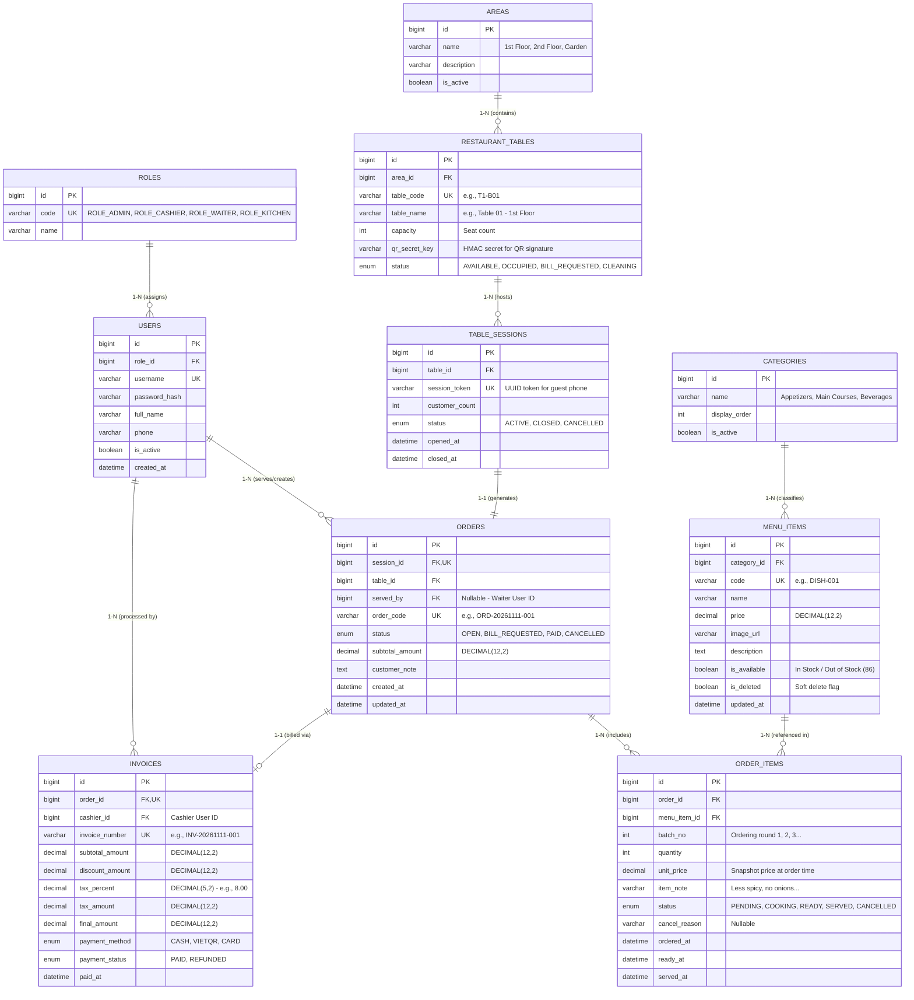

# System & Functional Specification Document

**Project Title:** Web-Based Restaurant Management System with QR Table Ordering & POS Cashier Integration  
**Team Size & Timeline:** 3 Students — Duration: 4 Weeks  
**Tech Stack:** Frontend JSP/JSTL (Bootstrap 5 + SockJS/STOMP.js + Fetch API), Backend Spring Boot (Spring MVC, Spring Data JPA, Spring Security + JWT, Spring WebSocket), Database MySQL 8.x, Build & Deploy Maven + Apache Tomcat.

## Architecture Overview & Technical Highlights

To fit a 4-week timeline for a 3-student team while delivering strong technical depth for the final defense, the system adopts a **Hybrid Server-Side Rendering (JSP/JSTL) + RESTful API + Real-Time WebSocket (STOMP)** architecture:
- **Dual Authentication Mechanism:**
  - **Internal Staff (`Waiter`, `Kitchen`, `Cashier`, `Admin`):** Authenticated via **JWT (JSON Web Token)** stored inside an `HttpOnly Cookie` (ensuring seamless authorization across both traditional JSP page navigations and AJAX REST API calls) combined with Spring Security Role-Based Access Control (`@PreAuthorize`).
  - **Dine-In Guests (`Guest QR`):** Frictionless access with no account registration required. Each table QR code embeds a `tableCode` and an `HMAC-SHA256` signature (`sig`). Scanning the QR initializes or joins an active `TableSession` with a short-lived `sessionToken` stored in a cookie, preventing off-premise users from reusing old QR photos to submit fake orders.
- **Real-Time State Synchronization (Zero-Reload UI):** Built on **Spring WebSocket with STOMP over SockJS**, pushing instant state transitions across 4 screens: Dine-in Guest (Mobile Web) $\leftrightarrow$ Kitchen Display System (KDS) $\leftrightarrow$ Waiter Tablet/Mobile $\leftrightarrow$ Cashier POS Screen without manual page refreshes.

## 1. Actors & Role-Based Access Control (RBAC)

The system defines 5 primary actors mapped to 1 guest session scope (`ROLE_GUEST_SESSION`) and 4 internal staff roles (`ROLE_WAITER`, `ROLE_KITCHEN`, `ROLE_CASHIER`, `ROLE_ADMIN`). In small-to-medium restaurant operations, a single staff account can be assigned both `ROLE_WAITER` and `ROLE_CASHIER`.

### 1.1. Detailed Actor Descriptions

1. **Dine-In Customer (`GUEST` — Authenticated via `QR Session Token`):**
   - Accesses the mobile-optimized web interface by scanning the physical QR standee placed on the restaurant table.
   - Browses the categorized digital menu, searches dishes by keyword, and views real-time item availability ("In Stock / Out of Stock").
   - Adds dishes to a shared table cart, attaches per-item modifiers/notes (e.g., *less spicy, no onions*), submits multiple ordering rounds (`Order Batch`) within a single dining session, and views all items ordered by tablemates.
   - Tracks real-time preparation progress per dish (`PENDING` $\rightarrow$ `COOKING` $\rightarrow$ `READY` $\rightarrow$ `SERVED`) and triggers instant "Call Waiter" or "Request Bill" alerts.

2. **Waiter / Floor Staff (`ROLE_WAITER`):**
   - Views the live floor plan grouped by zone (1st Floor, 2nd Floor, Garden): Opens new tables (`TableSession`), transfers or merges tables when guests relocate, and places assisted orders on behalf of guests via tablet/smartphone.
   - Receives real-time WebSocket alerts when: (1) A table submits a new order batch, (2) The kitchen marks an item `READY` for pickup, or (3) A guest taps "Call Waiter".
   - Confirms dish delivery to the table (`READY` $\rightarrow$ `SERVED`) and cancels `PENDING` items upon customer request.

3. **Chef / Barista (`ROLE_KITCHEN` — Kitchen Display System / KDS):**
   - Operates the KDS screen displaying incoming order tickets arranged strictly in **FIFO (First-In, First-Out)** order.
   - Receives audible chimes and visual card highlights immediately when a new order batch is placed.
   - Updates individual dish statuses (`PENDING` $\rightarrow$ `COOKING` $\rightarrow$ `READY`) or rejects an item (`CANCELLED` with a mandatory reason such as sudden ingredient depletion).
   - Toggles **Out-of-Stock (86'd)** status (`is_available = false`) with a single tap to immediately disable ordering for that dish across all active guest phones.

4. **Cashier (`ROLE_CASHIER` — POS Terminal):**
   - Monitors the POS dashboard showing all `OCCUPIED` tables and tables flashing `BILL_REQUESTED`.
   - Reviews consolidated multi-batch order items for a table, applies discount amounts/vouchers, calculates VAT, and prints a pre-calculation slip (Pre-bill).
   - Processes checkout payments (`CASH`, `VIETQR`, `CARD`), generates the final fiscal `Invoice`, closes the active `TableSession` (`CLOSED`), invalidates the table's `sessionToken`, and resets the table status to `AVAILABLE` (or `CLEANING`).

5. **Restaurant Manager / Administrator (`ROLE_ADMIN`):**
   - Configures core master data: Menu Categories & Dishes (CRUD operations, pricing, image upload, soft deletion).
   - Manages Dining Areas & Tables, and generates printable QR code sheets for each table.
   - Manages Staff Accounts & RBAC role assignments (create, update, lock/unlock staff accounts).
   - Accesses the Revenue & Analytics Dashboard (daily/weekly/monthly revenue charts, order counts, top-selling dishes, and cancellation audit logs).

### 1.2. RBAC Permission Matrix

| Module / Feature | Customer (`GUEST`) | Waiter (`WAITER`) | Kitchen (`KITCHEN`) | Cashier (`CASHIER`) | Admin (`ADMIN`) |
| :--- | :---: | :---: | :---: | :---: | :---: |
| Browse menu & Search dishes | R | R | R | R | CRUD |
| Quick toggle "Out of Stock" (`is_available`) | - | - | U | - | U |
| Manage floor plan & Generate table QR codes | - | R | - | R | CRUD |
| Open table session / Transfer table | Auto on QR scan | C / U | - | C / U | CRUD |
| Submit order batch (Order / Sub-order) | C | C | - | C | CRUD |
| Cancel `PENDING` order item | D (within 60s) | U / D | U (Reject item) | U / D | CRUD |
| Update cooking status (`COOKING`, `READY`) | R (Real-time) | R (Real-time) | U | R | U |
| Confirm dish served (`SERVED`) | R (Real-time) | U | R | R | U |
| Send assistance / Bill request alert | C | R / U | - | R / U | R |
| POS Checkout, apply discount & Print invoice | R (View subtotal) | - | - | C / R / U | CRUD |
| Staff account & RBAC management | - | - | - | - | CRUD |
| View revenue analytics & Top-selling items | - | - | - | R (Current shift) | R (Full history) |

*(Legend: **C** = Create, **R** = Read, **U** = Update, **D** = Delete/Cancel, **-** = No Access)*

## 2. Functional Requirements & User Stories

The 14 core User Stories below are scoped specifically for a 3-student team over a 4-week sprint cycle across 5 functional modules:

| US ID | Module | As a... | I want to... | So that... | Acceptance Criteria (AC) | Priority |
| :--- | :--- | :--- | :--- | :--- | :--- | :---: |
| **US-01** | **1. Menu Management** | Admin (`ADMIN`) | Create, update, and soft-delete menu categories and dishes with photos and prices | I can keep the restaurant menu and pricing accurate across seasons | 1. Validate unique dish name, price $> 0$, image format `.jpg/.png/.webp` $\le 5\text{MB}$.<br>2. Prevent `HARD DELETE` if a dish is referenced in historical orders; set `is_deleted = true`. | High |
| **US-02** | **1. Menu Management** | Chef (`KITCHEN`) / Admin (`ADMIN`) | Toggle a dish's availability (`is_available = false`) with a single click | Customers cannot order dishes that have run out of ingredients during the shift | 1. Toggling availability on KDS broadcasts a WebSocket message to `/topic/menu-status`.<br>2. The "Add to Cart" button for that dish on all active guest QR screens is disabled immediately without reloading. | High |
| **US-03** | **1. Menu Management** | Customer (`GUEST`) | View dishes grouped by category, filter by keyword, and inspect dish photos | I can quickly select items on my smartphone browser | 1. Mobile-first JSP/JSTL layout with smooth category switching.<br>2. Display formatted unit price and an "Out of Stock" badge when `is_available = false`. | High |
| **US-04** | **2. Table & Floor Plan** | Admin (`ADMIN`) | Manage dining areas/tables and generate printable QR codes per table | Each physical table has a unique, tamper-proof QR code for ordering | 1. Each table has a unique `table_code` (e.g., `T1-B01`) and `qr_secret_key`.<br>2. Dynamically render QR codes embedding `/qr/scan?tableCode=T1-B01&sig=...` with a print-friendly view (`window.print()`). | High |
| **US-05** | **2. Table & Floor Plan** | Waiter (`WAITER`) / Cashier (`CASHIER`) | View a color-coded live floor map and open or transfer tables | Staff can immediately see table occupancy and handle customer table changes | 1. Display 4 color states: `AVAILABLE` (Green), `OCCUPIED` (Amber), `BILL_REQUESTED` (Red-Orange), `CLEANING` (Gray).<br>2. Moving Table `A` to vacant Table `B` reassigns the active `TableSession` and `Order` to Table `B` and broadcasts via WebSocket. | High |
| **US-06** | **2. Table & Floor Plan** | Customer (`GUEST`) | Scan the table QR code to automatically start or join an active `TableSession` | Everyone at the same table can order together without creating accounts | 1. If the table is `AVAILABLE`, create a new `TableSession` (`session_token`) and transition the table to `OCCUPIED`.<br>2. If the table is already `OCCUPIED`, attach the guest to the existing `TableSession` so they see shared table orders. | High |
| **US-07** | **3. Real-Time Ordering** | Customer (`GUEST`) | Add items to the cart with custom notes and submit multiple ordering rounds | The kitchen receives exact preparation instructions for each round of ordering | 1. Support per-line `item_note` (e.g., *no onions, less ice*).<br>2. Each submission increments `batch_no` ($1, 2, \dots$) under the table's active `Order`.<br>3. Broadcast `NEW_ORDER_BATCH` to `/topic/kitchen/orders` immediately upon DB commit. | High |
| **US-08** | **3. Real-Time Ordering** | Chef (`KITCHEN`) | Receive real-time order tickets on the KDS and update item status (`PENDING` $\rightarrow$ `COOKING` $\rightarrow$ `READY`) | Dishes are cooked in FIFO order and waiters are notified immediately when food is ready | 1. New tickets append to the KDS queue dynamically with an audio alert (no page refresh).<br>2. Clicking "Start Cooking" (`COOKING`) or "Mark Ready" (`READY`) pushes real-time status updates to the Guest and Waiter screens. | High |
| **US-09** | **3. Real-Time Ordering** | Waiter (`WAITER`) | Receive instant alerts when dishes become `READY` and mark them `SERVED` upon delivery | Hot dishes are delivered promptly to the right table without missed items | 1. Waiter view highlights all `READY` items grouped by table code.<br>2. Marking an item `SERVED` updates the guest's phone screen and POS order summary in real time. | High |
| **US-10** | **3. Real-Time Ordering** | Customer (`GUEST`) / Waiter (`WAITER`) | Cancel an order item while it is still `PENDING` or send a "Call Staff" notification | Customers can fix ordering mistakes before cooking starts or request table service | 1. Allow cancellation strictly when `status == PENDING`; lock the cancel button once `status == COOKING`.<br>2. Tapping "Call Waiter / Request Bill" pushes an instant alert to `/topic/staff/alerts`. | Medium |
| **US-11** | **4. Billing & POS** | Cashier (`CASHIER`) | Review all ordering batches for a table on the POS screen, apply discounts, and compute VAT | The final bill is accurate and transparent before collecting payment | 1. Exclude `CANCELLED` items from subtotal calculation.<br>2. Warn the cashier if any items are still `PENDING` or `COOKING` before allowing checkout.<br>3. Automatically compute `final_amount = (subtotal - discount) + tax_amount`. | High |
| **US-12** | **4. Billing & POS** | Cashier (`CASHIER`) | Confirm payment (`CASH` / `VIETQR` / `CARD`), print the thermal receipt, and close the table session | The transaction is recorded in revenue reports and the table is freed for the next guests | 1. Create an immutable `Invoice` record, set `Order.status = PAID` and `TableSession.status = CLOSED`.<br>2. Invalidate the old `session_token` immediately so expired QR sessions cannot place new items.<br>3. Render an 80mm thermal receipt print dialog (`@media print`). | High |
| **US-13** | **5. Analytics & Admin** | Admin (`ADMIN`) | View a revenue dashboard filtered by date range alongside Top 5 best-selling dishes | I can track business performance and popular menu items | 1. Render daily/monthly revenue bar/line charts (Chart.js on JSP) aggregated strictly from `PAID` invoices.<br>2. Rank top menu items by total quantity sold and net revenue generated. | Medium |
| **US-14** | **5. Analytics & Admin** | Internal Staff (`ALL STAFF`) | Log in with staff credentials and get routed to my role-specific workspace via JWT | Internal POS, KDS, and Admin screens are protected from unauthorized access | 1. Verify `BCrypt` password hash and issue a signed `JWT` inside an `HttpOnly Cookie`.<br>2. Auto-redirect by role: `KITCHEN` $\rightarrow$ `/kds`, `CASHIER` $\rightarrow$ `/pos`, `WAITER` $\rightarrow$ `/waiter/tables`, `ADMIN` $\rightarrow$ `/admin/dashboard`. | High |

## 3. Core Business Workflows

### 3.1. Step-by-Step End-to-End Operational Flow

1. **Step 1 — QR Scan & Table Session Initialization:**
   - A customer sits at Table `T1-B05` and scans the table's QR code using their smartphone camera.
   - The browser sends `GET /qr/scan?tableCode=T1-B05&sig=9f8a7b...`.
   - The Spring Boot backend validates the HMAC signature `sig`. If the table is `AVAILABLE`, the system creates a new `TableSession` (`status = ACTIVE`), initializes an open `Order` (`status = OPEN`), updates the table status to `OCCUPIED`, sets the `GUEST_SESSION_TOKEN` cookie on the customer's browser, and broadcasts a WebSocket event to `/topic/tables` so the POS and Waiter floor maps immediately turn Table `T1-B05` amber (`OCCUPIED`).

2. **Step 2 — Menu Selection & Submitting an Order Batch:**
   - The customer selects dishes on the mobile JSP interface, adjusts quantities, enters per-item notes, and taps **"Place Order"**.
   - The frontend sends `POST /api/v1/guest/orders/items` carrying the `GUEST_SESSION_TOKEN` cookie.
   - The backend verifies that all selected dishes have `is_available == true`, assigns the next sequential `batch_no` ($1, 2, \dots$), persists the `OrderItem` rows with initial status `PENDING`, and recalculates `Order.subtotal_amount`.
   - Upon transaction commit, `SimpMessagingTemplate` pushes real-time JSON payloads to `/topic/kitchen/orders` and `/topic/orders/{orderId}`.

3. **Step 3 — Real-Time Kitchen Preparation (KDS Processing):**
   - The Kitchen Display System (KDS) subscribed to `/topic/kitchen/orders` receives the `NEW_ORDER_BATCH` event, plays an alert chime, and dynamically appends the new ticket card to the queue without reloading the page.
   - The chef taps **"Start Cooking"** $\rightarrow$ `PATCH /api/v1/kds/order-items/{itemId}/status` (`status = COOKING`). The backend updates MySQL and pushes an event to `/topic/orders/{orderId}` $\rightarrow$ the customer's mobile screen immediately updates the badge from *"Pending"* to *"Cooking"*.
   - Once plated, the chef taps **"Ready"** $\rightarrow$ `status = READY`. The backend broadcasts simultaneously to `/topic/orders/{orderId}` (updating the guest) and `/topic/waiter/notifications` (alerting floor staff).

4. **Step 4 — Table Delivery by Waiter (Order Fulfillment):**
   - The waiter receives a toast alert on their mobile/tablet: *"Dish [Rare Beef Pho x2] for Table T1-B05 is READY for pickup"*.
   - After serving the dish to the table, the waiter taps **"Mark Served"** $\rightarrow$ `PATCH /api/v1/waiter/order-items/{itemId}/serve` (`status = SERVED`). The status synchronizes across the guest phone and POS terminal.

5. **Step 5 — Bill Request & POS Cashier Checkout:**
   - After dining, the customer taps **"Request Bill"** on their phone (`POST /api/v1/guest/session/call-staff` with `type = BILL`).
   - Table `T1-B05` transitions to `BILL_REQUESTED` and flashes an alert on the Cashier POS terminal (`/topic/pos/alerts`).
   - The cashier opens Table `T1-B05` on the POS screen, reviews all ordered batches, enters any applicable discount, selects the payment method (`CASH` or `VIETQR`), and clicks **"Confirm Payment & Print Receipt"** (`POST /api/v1/pos/orders/{orderId}/checkout`).
   - The backend creates the `Invoice`, marks `Order.status = PAID`, closes `TableSession.status = CLOSED`, invalidates the `GUEST_SESSION_TOKEN`, resets the table status to `AVAILABLE` (or `CLEANING`), and pushes an `ORDER_PAID_CLOSED` WebSocket event to the guest's phone.

### 3.2. End-to-End Ordering & Checkout Sequence Diagram (Mermaid)

```mermaid
sequenceDiagram
    autonumber
    actor Guest as Customer (Mobile QR)
    participant App as Spring Boot Backend (REST + WS)
    actor KDS as Chef (KDS Screen)
    actor Waiter as Waiter (Staff App)
    actor POS as Cashier (POS Screen)
    database DB as MySQL Database

    Note over Guest, DB: PHASE 1: QR SCAN & TABLE SESSION INITIALIZATION
    Guest->>App: GET /qr/scan?tableCode=T1-B05&sig=...
    App->>DB: Verify HMAC signature & Create TableSession + Order (OPEN)
    DB-->>App: Return sessionToken & orderId
    App-->>POS: WS Broadcast [/topic/tables] (Table T1-B05 -> OCCUPIED)
    App-->>Guest: Set Cookie GUEST_SESSION_TOKEN & Render Menu Page (JSP)

    Note over Guest, DB: PHASE 2: PLACE ORDER BATCH & REAL-TIME KDS SYNC
    Guest->>App: POST /api/v1/guest/orders/items (Items + Modifiers/Notes)
    App->>DB: Validate availability & Insert OrderItems (status = PENDING)
    DB-->>App: Commit success (batchNo = 1)
    App-->>KDS: WS Push [/topic/kitchen/orders] (Event: NEW_ORDER_BATCH)
    App-->>POS: WS Push [/topic/pos/orders] (Update running subtotal for T1-B05)
    App-->>Guest: 201 Created (Display item statuses: PENDING)

    Note over KDS, Waiter: PHASE 3: KITCHEN PREPARATION & WAITER FULFILLMENT
    KDS->>App: PATCH /api/v1/kds/order-items/{id}/status (COOKING)
    App->>DB: Update OrderItem.status = COOKING
    App-->>Guest: WS Push [/topic/orders/{orderId}] (Item badge -> "Cooking")

    KDS->>App: PATCH /api/v1/kds/order-items/{id}/status (READY)
    App->>DB: Update OrderItem.status = READY
    App-->>Waiter: WS Push [/topic/waiter/notifications] (Pickup alert: Table T1-B05)
    App-->>Guest: WS Push [/topic/orders/{orderId}] (Item badge -> "Ready")

    Waiter->>App: PATCH /api/v1/waiter/order-items/{id}/serve (SERVED)
    App->>DB: Update OrderItem.status = SERVED
    App-->>Guest: WS Push [/topic/orders/{orderId}] (Item badge -> "Served")

    Note over Guest, DB: PHASE 4: BILL REQUEST & POS CHECKOUT
    Guest->>App: POST /api/v1/guest/session/call-staff (type: BILL)
    App->>DB: Update RestaurantTable.status = BILL_REQUESTED
    App-->>POS: WS Push [/topic/pos/alerts] (Table T1-B05 requested bill)

    POS->>App: POST /api/v1/pos/orders/{orderId}/checkout (paymentMethod, discount)
    App->>DB: Create Invoice (PAID), Close TableSession (CLOSED), Table -> AVAILABLE
    DB-->>App: Commit Transaction
    App-->>Guest: WS Push [/topic/orders/{orderId}] (Event: ORDER_PAID_CLOSED)
    App-->>POS: Return Invoice payload & Trigger 80mm Thermal Receipt Print
```

## 4. Database Schema Design

The MySQL database schema consists of **10 normalized tables (3NF)** designed to support multi-round table ordering (`batch_no`), historical price preservation (`unit_price` snapshotted inside `order_items` so future menu price edits never corrupt past invoices), and auditability.

### 4.1. Entity-Relationship Diagram (Mermaid ERD)



### 4.2. Table Specifications & Key Business Constraints

| # | Table Name | Primary Key (PK) | Foreign Keys (FK) | Key Fields, Constraints & Indexing Strategy |
| :-: | :--- | :--- | :--- | :--- |
| 1 | `roles` | `id` | - | `code` (`UNIQUE`, `NOT NULL`): Stores standard Spring Security role identifiers (`ROLE_ADMIN`, `ROLE_CASHIER`, `ROLE_WAITER`, `ROLE_KITCHEN`). |
| 2 | `users` | `id` | `role_id` $\rightarrow$ `roles(id)` | `username` (`UNIQUE`), `password_hash` (60-char BCrypt), `is_active` (deactivates former staff accounts while preserving historical invoice foreign keys). |
| 3 | `areas` | `id` | - | Stores dining zones (`name`, `is_active`) to filter tables cleanly on the POS and Waiter screens. |
| 4 | `restaurant_tables` | `id` | `area_id` $\rightarrow$ `areas(id)` | `table_code` (`UNIQUE`), `qr_secret_key` (used to sign QR URLs via `HMAC-SHA256`), `status` (`ENUM`: `AVAILABLE`, `OCCUPIED`, `BILL_REQUESTED`, `CLEANING`). |
| 5 | `table_sessions` | `id` | `table_id` $\rightarrow$ `restaurant_tables(id)` | Manages the lifecycle of each customer seating turnover. `session_token` (`UNIQUE`, Indexed) is issued to guest browsers and immediately invalidated when `status = CLOSED`. |
| 6 | `categories` | `id` | - | `display_order` (`INT`) controls the tab sequence on the mobile QR menu. |
| 7 | `menu_items` | `id` | `category_id` $\rightarrow$ `categories(id)` | `price` (`DECIMAL(12,2)`), `is_available` (instant 86 toggle on KDS), `is_deleted` (soft-delete flag preserving referential integrity for historical reports). |
| 8 | `orders` | `id` | `session_id` $\rightarrow$ `table_sessions(id)`<br>`table_id` $\rightarrow$ `restaurant_tables(id)`<br>`served_by` $\rightarrow$ `users(id)` | 1-to-1 with `TableSession`. `subtotal_amount` is dynamically recalculated from non-cancelled `order_items`. |
| 9 | `order_items` | `id` | `order_id` $\rightarrow$ `orders(id)`<br>`menu_item_id` $\rightarrow$ `menu_items(id)` | `batch_no` tracks ordering rounds; `unit_price` snapshots the price at order creation; composite index on `(status, ordered_at)` optimizes FIFO queries on the KDS screen. |
| 10 | `invoices` | `id` | `order_id` $\rightarrow$ `orders(id)`<br>`cashier_id` $\rightarrow$ `users(id)` | Stores immutable financial totals upon checkout: `final_amount = (subtotal_amount - discount_amount) + tax_amount`. Indexed on `paid_at` for fast date-range revenue aggregation. |

## 5. RESTful API Endpoints & WebSocket Events

Following a hybrid MVC design, view-rendering routes use standard Spring `@Controller` endpoints returning JSP views (e.g., `/login`, `/qr/menu`, `/kds`, `/pos`, `/admin/dashboard`), while all asynchronous state mutations and dynamic data fetches are exposed via `@RestController` under `/api/v1/...`.

### 5.1. RESTful API Endpoints Specification

| Module | Method | Endpoint | Description | Access Control (Auth / Role) |
| :--- | :---: | :--- | :--- | :--- |
| **Auth & QR Session** | `POST` | `/api/v1/auth/login` | Authenticate staff credentials, set JWT `HttpOnly Cookie`, and return role info | `PUBLIC` |
| **Auth & QR Session** | `POST` | `/api/v1/auth/logout` | Clear JWT cookie and terminate staff session | `Authenticated` |
| **Auth & QR Session** | `GET` | `/qr/scan` | Verify QR HMAC (`?tableCode=...&sig=...`), create/join `TableSession`, and redirect to JSP Menu | `PUBLIC` (Validates `sig`) |
| **Menu Management** | `GET` | `/api/v1/menu/categories` | Fetch active categories and non-deleted dishes (`is_deleted = false`) | `GUEST_TOKEN`, `ALL_STAFF` |
| **Menu Management** | `POST` | `/api/v1/admin/menu-items` | Create a new dish (supports `multipart/form-data` image upload) | `ROLE_ADMIN` |
| **Menu Management** | `PUT` | `/api/v1/admin/menu-items/{id}` | Update dish details, category, or price | `ROLE_ADMIN` |
| **Menu Management** | `PATCH` | `/api/v1/menu-items/{id}/availability` | Toggle dish availability (`is_available`) & broadcast WebSocket update | `ROLE_KITCHEN`, `ROLE_ADMIN` |
| **Menu Management** | `DELETE` | `/api/v1/admin/menu-items/{id}` | Soft-delete a dish (`is_deleted = true`) | `ROLE_ADMIN` |
| **Tables & Sessions** | `GET` | `/api/v1/tables/map` | Fetch floor plan grouped by area with live table statuses and running subtotals | `ROLE_WAITER`, `ROLE_CASHIER`, `ROLE_ADMIN` |
| **Tables & Sessions** | `POST` | `/api/v1/tables/{id}/open-session` | Manually open a new `TableSession` from Waiter/POS interface | `ROLE_WAITER`, `ROLE_CASHIER`, `ROLE_ADMIN` |
| **Tables & Sessions** | `POST` | `/api/v1/tables/transfer` | Transfer active session and open order from `sourceTableId` to `targetTableId` | `ROLE_WAITER`, `ROLE_CASHIER`, `ROLE_ADMIN` |
| **Tables & Sessions** | `GET` | `/api/v1/admin/tables/{id}/qr` | Generate signed QR URL and printable QR image for a specific table | `ROLE_ADMIN` |
| **Ordering & KDS** | `GET` | `/api/v1/guest/orders/current` | Retrieve current table order details and live item statuses for the guest session | `GUEST_TOKEN` |
| **Ordering & KDS** | `POST` | `/api/v1/guest/orders/items` | Submit a new batch of ordered items (`batch_no` auto-incremented) | `GUEST_TOKEN` |
| **Ordering & KDS** | `POST` | `/api/v1/orders/{orderId}/items` | Waiter/Cashier adds items to an existing table order on behalf of guests | `ROLE_WAITER`, `ROLE_CASHIER` |
| **Ordering & KDS** | `GET` | `/api/v1/kds/queue` | Fetch active `PENDING` and `COOKING` items ordered by FIFO (`ordered_at ASC`) | `ROLE_KITCHEN`, `ROLE_ADMIN` |
| **Ordering & KDS** | `PATCH` | `/api/v1/kds/order-items/{itemId}/status` | Chef updates item status (`COOKING`, `READY`, or `CANCELLED` with reason) | `ROLE_KITCHEN`, `ROLE_ADMIN` |
| **Ordering & KDS** | `PATCH` | `/api/v1/waiter/order-items/{itemId}/serve` | Waiter confirms dish delivery to table (`READY` $\rightarrow$ `SERVED`) | `ROLE_WAITER`, `ROLE_ADMIN` |
| **Ordering & KDS** | `DELETE` | `/api/v1/order-items/{itemId}` | Cancel an order item while its status is still `PENDING` | `GUEST_TOKEN` (first 60s), `ROLE_WAITER`, `ROLE_CASHIER` |
| **Ordering & KDS** | `POST` | `/api/v1/guest/session/call-staff` | Guest triggers "Call Waiter" or "Request Bill" alert (`type: ASSIST \| BILL`) | `GUEST_TOKEN` |
| **POS & Billing** | `GET` | `/api/v1/pos/orders/{orderId}/summary` | Retrieve consolidated bill preview (subtotal, tax, unserved item warnings) | `ROLE_CASHIER`, `ROLE_ADMIN` |
| **POS & Billing** | `POST` | `/api/v1/pos/orders/{orderId}/checkout` | Finalize payment, generate `Invoice`, close `TableSession`, and free the table | `ROLE_CASHIER`, `ROLE_ADMIN` |
| **POS & Billing** | `GET` | `/api/v1/pos/invoices/{invoiceId}/print` | Render 80mm thermal receipt JSP view for printing | `ROLE_CASHIER`, `ROLE_ADMIN` |
| **Reports & Staff** | `GET` | `/api/v1/admin/reports/revenue` | Aggregate revenue and paid order counts by date range (`?from=YYYY-MM-DD&to=YYYY-MM-DD`) | `ROLE_ADMIN` |
| **Reports & Staff** | `GET` | `/api/v1/admin/reports/top-items` | Retrieve top-selling menu items ranked by quantity sold and revenue | `ROLE_ADMIN` |
| **Reports & Staff** | `GET/POST/PUT` | `/api/v1/admin/users` | Manage staff user accounts and role assignments | `ROLE_ADMIN` |

### 5.2. Real-Time WebSocket Events Specification (STOMP over SockJS)

- **WebSocket Handshake Endpoint:** `/ws-restaurant` (enabled with `.withSockJS()`).
- **Message Broker Prefix:** `/topic` (Pub/Sub Broadcast).
- **Application Destination Prefix:** `/app`.

| Event Type | STOMP Topic Destination | Publisher | Subscribers | Sample JSON Payload |
| :--- | :--- | :--- | :--- | :--- |
| **`NEW_ORDER_BATCH`** | `/topic/kitchen/orders` | Backend (after Guest/Waiter submits items) | Kitchen Display (`KDS`), Cashier (`POS`) | `{"event":"NEW_ORDER_BATCH", "orderId":105, "tableCode":"T1-B05", "batchNo":2, "orderedAt":"2026-11-11T19:15:00", "items":[{"itemId":412, "name":"Shaking Beef", "qty":2, "note":"Well done"}]}` |
| **`ITEM_STATUS_CHANGED`** | `/topic/orders/{orderId}` | Backend (when Chef or Waiter updates item status) | Guest Phones at that table (`GUEST`), `POS` | `{"event":"ITEM_STATUS_CHANGED", "orderId":105, "itemId":412, "itemName":"Shaking Beef", "oldStatus":"PENDING", "newStatus":"COOKING", "updatedAt":"2026-11-11T19:17:30"}` |
| **`ITEM_READY_TO_SERVE`** | `/topic/waiter/notifications` | Backend (when Chef marks item `READY` or `CANCELLED`) | Waiter Devices (`WAITER`) | `{"event":"ITEM_READY_TO_SERVE", "tableCode":"T1-B05", "tableName":"Table 05 - 1st Floor", "itemId":412, "itemName":"Shaking Beef", "qty":2}` |
| **`MENU_AVAILABILITY_UPDATED`** | `/topic/menu-status` | Backend (when Chef/Admin toggles Out-of-Stock) | All active `GUEST` menu screens, `WAITER`, `POS` | `{"event":"MENU_AVAILABILITY_UPDATED", "menuItemId":18, "menuItemName":"Pan-Seared Salmon", "isAvailable":false}` |
| **`TABLE_STATUS_CHANGED`** | `/topic/tables` | Backend (on table open, transfer, bill request, or checkout) | `POS` and `WAITER` floor map screens | `{"event":"TABLE_STATUS_CHANGED", "tableId":5, "tableCode":"T1-B05", "status":"BILL_REQUESTED", "currentSubtotal":485000}` |
| **`CUSTOMER_CALL_STAFF`** | `/topic/staff/alerts` | Backend (when Guest taps "Call Waiter / Request Bill") | `WAITER` and `POS` screens | `{"event":"CUSTOMER_CALL_STAFF", "tableCode":"T1-B05", "callType":"REQUEST_BILL", "message":"Table T1-B05 requested the bill", "timestamp":"2026-11-11T20:05:12"}` |
| **`ORDER_PAID_CLOSED`** | `/topic/orders/{orderId}` | Backend (when Cashier completes POS checkout) | Guest Phones at that table (`GUEST`) | `{"event":"ORDER_PAID_CLOSED", "orderId":105, "invoiceNo":"INV-20261111-019", "finalAmount":523800, "message":"Thank you for dining with us! Your session is now closed."}` |

## 6. Recommended 4-Week Work Breakdown Structure (3 Students)

To prevent Git merge conflicts and ensure balanced workload distribution across the 3 team members over 4 weeks:

| Week | Student 1 (Auth, Core Table/QR & POS Cashier) | Student 2 (Guest QR Ordering & Real-Time KDS) | Student 3 (Admin CRUD, Menu & Revenue Analytics) |
| :---: | :--- | :--- | :--- |
| **Week 1** | Design MySQL schema (SQL/Flyway), initialize Spring Boot + JSP/JSTL project skeleton, configure Spring Security + JWT `HttpOnly Cookie`. | Configure Spring WebSocket (STOMP + SockJS) broker, build mobile-first JSP layout for Guest QR menu browsing. | Build Category & Menu Item CRUD modules (multipart image upload, validation, soft delete) and Area/Table CRUD. |
| **Week 2** | Implement QR scan verification (`HMAC`), `TableSession` lifecycle, and interactive Floor Plan Map for Waiter/POS. | Build client-side cart, multi-batch order submission API (`batch_no`), and real-time WebSocket push to KDS. | Implement dynamic QR Code generator & printable sheet view, plus Staff Account Management (RBAC). |
| **Week 3** | Develop POS Cashier terminal: live table bill summary, discount/tax calculation, Checkout transaction & 80mm thermal receipt print view. | Build KDS screen for Chefs (`PENDING` $\rightarrow$ `COOKING` $\rightarrow$ `READY`), Waiter pickup/serve flow (`SERVED`), and instant Out-of-Stock toggle. | Build Admin Revenue & Analytics Dashboard (Chart.js integration), historical invoice lookup, and Top-Selling Dishes report. |
| **Week 4** | End-to-end integration testing (QR $\rightarrow$ KDS $\rightarrow$ Waiter $\rightarrow$ POS), edge-case handling (item cancellation, table transfer). | Polish Mobile & Tablet UX/UI, add WebSocket sound alerts on KDS/POS, and test concurrent multi-phone ordering on the same table. | Prepare seed data, write final project report documentation, and rehearse the live end-to-end defense demo. |
