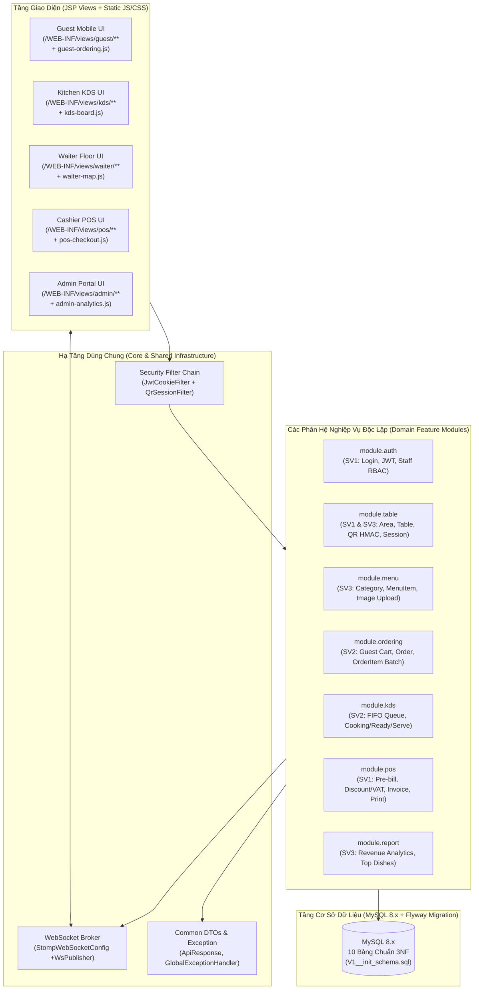
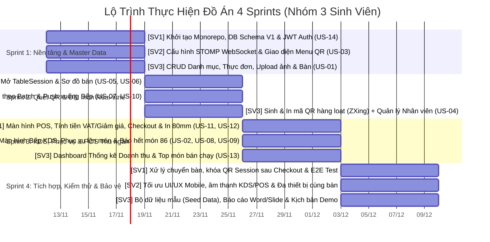

# Kiến Trúc Monorepo & Kế Hoạch Phân Chia Công Việc Theo Sprint (4 Sprints)

**Dự án:** Web-Based Restaurant Management System with QR Table Ordering & POS Cashier Integration  
**Quy mô nhóm:** 3 Sinh viên — **Thời lượng:** 4 Sprints (1 Tuần / Sprint)  
**Tech Stack:** Spring Boot (WAR Packaging), JSP/JSTL + Bootstrap 5, Spring Security (JWT + QR HMAC Session), Spring WebSocket (STOMP/SockJS), Spring Data JPA + Flyway, MySQL 8.x, Maven, Apache Tomcat.

## 1. Kiến Trúc Monorepo (Modular Monorepo Architecture)

Với đặc thù công nghệ **Spring Boot kết hợp JSP/JSTL** (bắt buộc đóng gói dạng `WAR` chạy trên Embedded/External Apache Tomcat để biên dịch các file `.jsp` trong `src/main/webapp/WEB-INF/views/`), việc tách thành nhiều dự án rời rạc sẽ làm phức tạp hóa quá trình cấu hình Session/Cookie và biên dịch JSP. Do đó, kiến trúc tối ưu nhất cho nhóm 3 sinh viên là **Monorepo tổ chức theo Package-by-Feature (Modular Monolith)** kết hợp thư mục `database/`, `docs/` và `scripts/` trong cùng một Git Repository.

### 1.1. Sơ đồ Kiến trúc Phân tầng & Luồng Phụ thuộc trong Monorepo (Mermaid)



### 1.2. Cấu trúc Cây Thư mục Monorepo Chi tiết (Directory Tree)

Thiết kế cây thư mục dưới đây phân tách rạch ròi phạm vi file giữa **SV1**, **SV2**, và **SV3** ở cả tầng Java Backend, JSP Views và JavaScript tĩnh để **triệt tiêu xung đột Git (Git Merge Conflicts)**:

```text
TAQ_Restaurant/
├── README.md                                  # Hướng dẫn cài đặt, chạy lệnh Maven & tài khoản test
├── .gitignore                                 # Bỏ qua target/, .idea/, uploads/
├── docker-compose.yml                         # Khởi tạo nhanh MySQL 8.0 + phpMyAdmin đồng nhất cho cả 3 máy
├── pom.xml                                    # Maven configuration (packaging: war, Spring Boot, Jasper JSP, JWT, ZXing QR)
│
├── spec/general                                        # [DÙNG CHUNG] Tài liệu thiết kế & Kiểm thử
│   ├── general_spec.md                                 # Bản đặc tả kỹ thuật & nghiệp vụ (Tiếng Anh)
│   ├── monorepo_architecture_and_sprint.md             # Tài liệu kiến trúc Monorepo & phân chia Sprint
│   └── postman/
│       └── restaurant-qr-pos.postman_collection.json
│
├── uploads/                                   # Thư mục lưu ảnh món ăn & mã QR sinh ra ở môi trường Local
│   ├── menu-images/
│   └── qr-codes/
│
└── src/
    ├── main/
    │   ├── java/com/restaurant/qrpos/
    │   │   ├── QrPosRestaurantApplication.java
    │   │   ├── ServletInitializer.java        # Bắt buộc cho Spring Boot chạy JSP/WAR trên Tomcat
    │   │   │
    │   │   ├── common/                        # [SV1 khởi tạo ở Tuần 1 - Dùng chung]
    │   │   │   ├── dto/
    │   │   │   │   ├── ApiResponse.java       # Chuẩn JSON trả về chung: {success, message, data, timestamp}
    │   │   │   │   └── WsEventMessage.java    # Chuẩn Payload WebSocket chung: {event, data, timestamp}
    │   │   │   ├── enums/                     # TableStatus, SessionStatus, OrderStatus, OrderItemStatus, PaymentMethod
    │   │   │   ├── exception/                 # GlobalExceptionHandler, BusinessException, ResourceNotFoundException
    │   │   │   └── util/                      # HmacQrUtil (Ký & kiểm tra QR), FileUploadUtil, QrGeneratorUtil (ZXing)
    │   │   │
    │   │   ├── config/                        # [SV1 & SV2 cấu hình ở Tuần 1]
    │   │   │   ├── SecurityConfig.java        # [SV1] Cấu hình chuỗi Filter cho Staff (JWT) & Guest (QR Session)
    │   │   │   ├── WebMvcConfig.java          # [SV3] Cấu hình ViewResolver JSP & ResourceHandler cho thư mục /uploads/**
    │   │   │   └── WebSocketConfig.java       # [SV2] Cấu hình STOMP endpoint (/ws-restaurant) & Broker (/topic, /app)
    │   │   │
    │   │   ├── security/                      # [SV1 phụ trách]
    │   │   │   ├── JwtTokenProvider.java
    │   │   │   ├── JwtCookieAuthenticationFilter.java
    │   │   │   ├── GuestSessionAuthenticationFilter.java
    │   │   │   └── CustomUserDetailsService.java
    │   │   │
    │   │   ├── entity/                        # [SV1 khởi tạo 10 Entity chuẩn theo ERD ở đầu Sprint 1]
    │   │   │   ├── Role.java
    │   │   │   ├── User.java
    │   │   │   ├── Area.java
    │   │   │   ├── RestaurantTable.java
    │   │   │   ├── TableSession.java
    │   │   │   ├── Category.java
    │   │   │   ├── MenuItem.java
    │   │   │   ├── Order.java
    │   │   │   ├── OrderItem.java
    │   │   │   └── Invoice.java
    │   │   │
    │   │   └── modules/                       # [PHÂN VÙNG CODE ĐỘC LẬP CHO 3 SINH VIÊN]
    │   │       ├── auth/                      # === [SV1] Xác thực nhân sự & Điều hướng Role ===
    │   │       │   ├── controller/            # AuthViewController.java, AuthRestController.java
    │   │       │   ├── dto/                   # LoginRequest.java, AuthUserResponse.java
    │   │       │   └── service/               # AuthService.java
    │   │       │
    │   │       ├── table/                     # === [SV1 & SV3] Quản lý Bàn, QR Scan & Phiên bàn ===
    │   │       │   ├── controller/
    │   │       │   │   ├── QrScanController.java          # [SV1] GET /qr/scan (Verify HMAC -> Mở TableSession)
    │   │       │   │   ├── TableMapRestController.java    # [SV1] Sơ đồ bàn trực tiếp, Mở/Chuyển bàn
    │   │       │   │   └── AdminTableRestController.java  # [SV3] CRUD Khu vực/Bàn & Sinh mã QR in ấn
    │   │       │   ├── dto/
    │   │       │   ├── repository/            # AreaRepository, RestaurantTableRepository, TableSessionRepository
    │   │       │   └── service/               # TableSessionService.java (SV1), AdminTableQrService.java (SV3)
    │   │       │
    │   │       ├── menu/                      # === [SV3] Quản lý Danh mục & Thực đơn ===
    │   │       │   ├── controller/            # PublicMenuRestController.java, AdminMenuRestController.java
    │   │       │   ├── dto/                   # CategoryDto.java, MenuItemRequest.java, MenuItemResponse.java
    │   │       │   ├── repository/            # CategoryRepository.java, MenuItemRepository.java
    │   │       │   └── service/               # MenuService.java
    │   │       │
    │   │       ├── ordering/                  # === [SV2] Khách gọi món theo lượt (Batch) & Gọi nhân viên ===
    │   │       │   ├── controller/            # GuestViewController.java, GuestOrderRestController.java
    │   │       │   ├── dto/                   # PlaceOrderBatchRequest.java, OrderDetailResponse.java
    │   │       │   ├── repository/            # OrderRepository.java, OrderItemRepository.java
    │   │       │   └── service/               # OrderingService.java, RealtimeNotificationService.java
    │   │       │
    │   │       ├── kds/                       # === [SV2] Màn hình Bếp (KDS) & Phục vụ lên món (Waiter) ===
    │   │       │   ├── controller/            # KdsViewController.java, KdsRestController.java, WaiterRestController.java
    │   │       │   ├── dto/                   # KdsTicketDto.java, UpdateItemStatusRequest.java
    │   │       │   └── service/               # KdsKitchenService.java
    │   │       │
    │   │       ├── pos/                       # === [SV1] Thu ngân POS, Tính tiền & Xuất Hóa đơn 80mm ===
    │   │       │   ├── controller/            # PosViewController.java, PosCheckoutRestController.java
    │   │       │   ├── dto/                   # BillSummaryResponse.java, CheckoutRequest.java, InvoicePrintDto.java
    │   │       │   ├── repository/            # InvoiceRepository.java
    │   │       │   └── service/               # PosCheckoutService.java
    │   │       │
    │   │       └── admin/                     # === [SV3] Quản trị Nhân viên (RBAC) & Thống kê Doanh thu ===
    │   │           ├── controller/            # AdminViewController.java, AdminUserRestController.java, ReportRestController.java
    │   │           ├── dto/                   # StaffUserDto.java, RevenueReportDto.java, TopDishDto.java
    │   │           ├── repository/            # UserRepository.java, RoleRepository.java
    │   │           └── service/               # StaffUserService.java, RevenueAnalyticsService.java
    │   │
    │   ├── resources/
    │   │   ├── application.yml                # Cấu hình chung (Port 8080, View prefix/suffix, Jackson, Multipart)
    │   │   ├── application-dev.yml            # Cấu hình kết nối MySQL Local
    │   │   └── db/migration/                  # Flyway tự động chạy khi bật ứng dụng
    │   │       ├── V1__init_schema.sql        # [SV1] Tạo 10 bảng chuẩn 3NF + Indexes
    │   │       └── V2__seed_initial_data.sql  # [SV3] Seed 4 Roles, 4 tài khoản mẫu, 3 Khu vực, 12 Bàn, 15 Món ăn
    │   │
    │   └── webapp/
    │       ├── resources/static/              # Tách file JS/CSS riêng theo từng phân hệ để không đụng code
    │       │   ├── css/
    │       │   │   ├── common.css
    │       │   │   ├── guest-mobile.css       # [SV2] Giao diện Mobile QR
    │       │   │   ├── kds-board.css          # [SV2] Giao diện KDS màn hình ngang
    │       │   │   ├── pos-terminal.css       # [SV1] Giao diện POS & CSS @media print khổ 80mm
    │       │   │   └── admin-dashboard.css    # [SV3] Giao diện Admin
    │       │   └── js/
    │       │       ├── core/
    │       │       │   ├── api-client.js      # [SV1] Hàm wrapper Fetch API chuẩn hóa xử lý lỗi
    │       │       │   └── ws-client.js       # [SV2] Hàm kết nối SockJS/STOMP tự động reconnect
    │       │       ├── guest-ordering.js      # [SV2] Giỏ hàng LocalStorage, gửi Batch Order, nhận trạng thái món
    │       │       ├── kds-realtime.js        # [SV2] Nhận đơn mới, chuông báo, đổi trạng thái COOKING/READY, bật/tắt 86
    │       │       ├── waiter-operations.js   # [SV2 & SV1] Nhận thông báo bưng món READY -> SERVED, sơ đồ bàn
    │       │       ├── pos-checkout.js        # [SV1] Tính tiền, áp giảm giá/VAT, Checkout, mở cửa sổ in
    │       │       └── admin-management.js    # [SV3] CRUD Menu, In QR bàn, Biểu đồ doanh thu Chart.js
    │       │
    │       └── WEB-INF/views/                 # Các trang JSP chia theo đúng Role
    │           ├── fragments/                 # Header, Sidebar, Toast Notification, Modal dùng chung (JSTL)
    │           ├── auth/                      # [SV1] login.jsp, access-denied.jsp
    │           ├── guest/                     # [SV2] qr-menu.jsp, order-tracking.jsp, session-closed.jsp
    │           ├── kds/                       # [SV2] kitchen-display.jsp
    │           ├── waiter/                    # [SV1 & SV2] floor-plan.jsp, ready-pickup.jsp
    │           ├── pos/                       # [SV1] pos-terminal.jsp, invoice-print-80mm.jsp
    │           └── admin/                     # [SV3] dashboard.jsp, menu-crud.jsp, table-qr.jsp, staff-crud.jsp
    │
    └── test/java/com/restaurant/qrpos/        # Unit Test & Integration Test cho các luồng cốt lõi
```

## 2. Phân Vai & Quy Ước Làm Việc Nhóm Trên Monorepo

### 2.1. Phân công Trách nhiệm Chuyên sâu (Role Ownership)

| Thành viên | Vai trò trong nhóm | Phân hệ phụ trách chính (Modules) | Các User Stories đảm nhận | Trọng tâm kỹ thuật khi bảo vệ đồ án |
| :--- | :--- | :--- | :---: | :--- |
| **Sinh viên 1 (SV1)** | **Tech Lead / Security, Table Session & POS Engineer** | `security`, `modules.auth`, `modules.table` (luồng QR Scan & Floor Map), `modules.pos` | **US-05, US-06, US-11, US-12, US-14** | Cơ chế xác thực kép (`JWT HttpOnly Cookie` + `QR HMAC Signature & Session Token`), Transaction chốt hóa đơn POS & giải phóng bàn. |
| **Sinh viên 2 (SV2)** | **Real-Time WebSocket, Guest Ordering & KDS Engineer** | `config.WebSocketConfig`, `modules.ordering`, `modules.kds` (Kitchen & Waiter fulfillment) | **US-02, US-03, US-07, US-08, US-09, US-10** | Kiến trúc STOMP over SockJS, đặt món nhiều lượt (`batch_no`), đồng bộ trạng thái `PENDING` $\rightarrow$ `COOKING` $\rightarrow$ `READY` $\rightarrow$ `SERVED` không cần tải lại trang. |
| **Sinh viên 3 (SV3)** | **Master Data, QR Generator & Analytics Engineer** | `modules.menu`, `modules.table` (CRUD Bàn & Sinh mã QR), `modules.admin` (Staff RBAC & Revenue Dashboard) | **US-01, US-04, US-13** (+ CRUD Staff hỗ trợ **US-14**) | Xử lý Upload ảnh Multipart, Soft Delete bảo toàn khóa ngoại, thư viện ZXing sinh mã QR động hàng loạt, truy vấn агреgation thống kê doanh thu & Chart.js. |

### 2.2. Quy tắc Git Workflow chống xung đột (Zero-Conflict Rules)

1. **Chiến lược nhánh (Git Branching):**
   - `main`: Nhánh ổn định chỉ nhận code sau khi kết thúc mỗi Sprint Demo.
   - `develop`: Nhánh tích hợp chung của cả nhóm.
   - Nhánh tính năng cá nhân đặt tên theo cú pháp: `feat/sv1-jwt-auth`, `feat/sv2-kds-websocket`, `feat/sv3-menu-crud`.
2. **Quy tắc bất biến với Database (`Flyway`):**
   - Ngay ngày thứ 2 của **Sprint 1**, cả 3 thành viên chốt cứng file `V1__init_schema.sql` và 10 class `Entity`.
   - Từ Sprint 2 trở đi, nếu ai cần thêm cột hoặc sửa bảng, **tuyệt đối không sửa đè vào `V1__init_schema.sql`** mà phải tạo file migration mới (ví dụ: `V3__add_column_xyz.sql`) để Flyway tự động cập nhật cho 2 bạn còn lại khi `git pull`.
3. **Quy tắc cách ly Frontend JSP & JS:**
   - Mỗi sinh viên chỉ sửa trong thư mục `/WEB-INF/views/<phân-hệ-của-mình>/` và file `.js` riêng của mình trong `/resources/static/js/`.

## 3. Kế Hoạch Phân Chia Công Việc Chi Tiết Theo 4 Sprints

### 3.1. Sơ đồ Tiến độ Tổng thể 4 Sprints (Mermaid Gantt Chart)



### 3.2. Sprint 1 (Tuần 1): Dựng Khung Monorepo, Xác Thực JWT & Quản Trị Thực Đơn Cốt Lõi

- **Mục tiêu Sprint 1 (Sprint Goal):** Cả 3 máy chạy được dự án từ Monorepo chỉ bằng 1 lệnh `mvn spring-boot:run`; hoàn thành Database 10 bảng, đăng nhập phân quyền JWT (`US-14`), CRUD Thực đơn (`US-01`) và hiển thị thực đơn lên giao diện Mobile của khách (`US-03`).

| Mã Task | US Liên kết | Phụ trách | Đầu việc kỹ thuật cụ thể (Deliverables & Paths) | Điều kiện hoàn thành (Definition of Done - DoD) |
| :--- | :---: | :---: | :--- | :--- |
| **S1-T1** | Hạ tầng | **SV1** | - Khởi tạo Maven WAR project, `docker-compose.yml` (MySQL 8).<br>- Viết `V1__init_schema.sql` (10 bảng) và tạo đủ 10 class JPA `Entity` + `Enums`.<br>- Xây dựng `ApiResponse<T>` và `GlobalExceptionHandler`. | Ứng dụng khởi động thành công, Flyway tự tạo 10 bảng trong MySQL không báo lỗi. |
| **S1-T2** | **US-14** | **SV1** | - Cấu hình Spring Security (`SecurityConfig`), `BCryptPasswordEncoder`.<br>- Viết `JwtTokenProvider`, `JwtCookieAuthenticationFilter`.<br>- Xây dựng `POST /api/v1/auth/login`, `/logout` và trang `/WEB-INF/views/auth/login.jsp`. | Đăng nhập tài khoản mẫu nhận được `HttpOnly Cookie` chứa JWT và tự động redirect đúng trang theo Role (`ADMIN`, `CASHIER`, `WAITER`, `KITCHEN`). |
| **S1-T3** | Hạ tầng WS | **SV2** | - Cấu hình `WebSocketConfig.java` (Endpoint `/ws-restaurant`, Broker `/topic`, `/app`).<br>- Viết thư viện JS dùng chung `/static/js/core/ws-client.js` (tự động kết nối STOMP/SockJS và subscribe). | Mở 2 tab trình duyệt gửi/nhận thử bản tin JSON qua kênh `/topic/ping` thành công. |
| **S1-T4** | **US-03** | **SV2** | - Xây dựng giao diện Mobile-First `/WEB-INF/views/guest/qr-menu.jsp` (thanh trượt Category, ô tìm kiếm món, thẻ món ăn, nút thêm vào giỏ).<br>- Tích hợp `GET /api/v1/menu/categories` để render danh sách món ăn. | Giao diện hiển thị chuẩn trên khung nhìn iPhone/Android (Chrome DevTools), lọc món theo danh mục và từ khóa mượt mà. |
| **S1-T5** | **US-01** | **SV3** | - Xây dựng CRUD Danh mục (`Category`) và Món ăn (`MenuItem`):<br>  + `POST/PUT/DELETE /api/v1/admin/menu-items`<br>  + Xử lý upload file ảnh món ăn vào `/uploads/menu-images/`.<br>  + Xử lý `Soft Delete` (`is_deleted = true`).<br>- Dựng trang `/WEB-INF/views/admin/menu-crud.jsp`. | Admin thêm/sửa/xóa mềm món ăn kèm hình ảnh thành công; món đã xóa mềm không hiển thị trên trang Menu của khách. |
| **S1-T6** | Hạ tầng | **SV3** | - Viết script `V2__seed_initial_data.sql` tạo sẵn 4 Roles, 4 Users mẫu, 3 Khu vực (Tầng 1, Tầng 2, Sân vườn), 12 Bàn ăn và 15 Món ăn có sẵn ảnh mẫu. | Cả nhóm pull code về có sẵn dữ liệu phong phú để test ngay không cần nhập tay. |

- **Điểm mốc Tích hợp cuối Sprint 1 (Integration Checkpoint 1):** Admin (**SV3**) đăng nhập qua màn hình Login (**SV1**), thêm một món ăn mới kèm ảnh $\rightarrow$ Khách mở trang Menu (**SV2**) thấy ngay món ăn vừa thêm.

### 3.3. Sprint 2 (Tuần 2): Bảo Mật Mã QR, Phiên Bàn (`TableSession`) & Đặt Món Real-Time

- **Mục tiêu Sprint 2 (Sprint Goal):** Khép kín luồng từ lúc Admin in mã QR dán lên bàn (`US-04`) $\rightarrow$ Khách quét mã QR mở phiên bàn (`US-06`) $\rightarrow$ Sơ đồ bàn đổi màu trực tiếp (`US-05`) $\rightarrow$ Khách đặt món nhiều lượt đẩy thẳng xuống hàng đợi Bếp (`US-07`, `US-10`).

| Mã Task | US Liên kết | Phụ trách | Đầu việc kỹ thuật cụ thể (Deliverables & Paths) | Điều kiện hoàn thành (Definition of Done - DoD) |
| :--- | :---: | :---: | :--- | :--- |
| **S2-T1** | **US-06** | **SV1** | - Xây dựng `HmacQrUtil` ký và xác thực chuỗi `sig = HMAC_SHA256(tableCode, qrSecretKey)`.<br>- Xây dựng `GET /qr/scan?tableCode=...&sig=...` và `GuestSessionAuthenticationFilter`.<br>- Xử lý logic: Nếu bàn `AVAILABLE` $\rightarrow$ tạo `TableSession` + `Order` mới; nếu `OCCUPIED` $\rightarrow$ cho phép tham gia chung phiên bàn hiện tại. | Quét URL hợp lệ nhận được cookie `GUEST_SESSION_TOKEN` và vào trang Menu của đúng bàn đó; sửa sai `sig` trên URL lập tức bị chặn (403 Forbidden). |
| **S2-T2** | **US-05** | **SV1** | - Xây dựng API Sơ đồ bàn `GET /api/v1/tables/map`, mở bàn thủ công `POST /api/v1/tables/{id}/open-session` và chuyển bàn `POST /api/v1/tables/transfer`.<br>- Xây dựng giao diện `/WEB-INF/views/waiter/floor-plan.jsp` hiển thị 4 màu trạng thái bàn và lắng nghe `/topic/tables`. | Khi khách quét QR ở máy điện thoại, ô bàn tương ứng trên màn hình Waiter/POS tự động chuyển từ màu Xanh (`AVAILABLE`) sang Vàng (`OCCUPIED`) ngay lập tức. |
| **S2-T3** | **US-07** | **SV2** | - Xây dựng giỏ hàng trên `guest-ordering.js`, cho phép nhập ghi chú từng món (`item_note`).<br>- Xây dựng API `POST /api/v1/guest/orders/items` (tự động tăng `batch_no = 1, 2...`, lưu `unit_price` snapshot, tính lại `Order.subtotal_amount`).<br>- Phát sự kiện WebSocket `NEW_ORDER_BATCH` tới `/topic/kitchen/orders`. | Khách đặt 2 lượt liên tiếp tạo đúng `batch_no = 1` và `batch_no = 2` trong bảng `order_items`; tổng tiền tạm tính cập nhật chính xác. |
| **S2-T4** | **US-10** | **SV2** | - Xây dựng trang theo dõi đơn của khách `/WEB-INF/views/guest/order-tracking.jsp` kết nối `GET /api/v1/guest/orders/current`.<br>- Xây dựng API hủy món `DELETE /api/v1/order-items/{itemId}` (chỉ cho phép khi `status == PENDING`) và API gọi nhân viên `POST /api/v1/guest/session/call-staff`. | Khách hủy được món đang `PENDING`; khi bấm "Gọi nhân viên", màn hình Phục vụ/POS nhận được popup cảnh báo kèm âm thanh. |
| **S2-T5** | **US-04** | **SV3** | - Xây dựng CRUD Khu vực (`Area`) và Bàn ăn (`RestaurantTable`).<br>- Tích hợp thư viện `com.google.zxing` sinh ảnh QR Code cho từng bàn (`GET /api/v1/admin/tables/{id}/qr`).<br>- Xây dựng trang `/WEB-INF/views/admin/table-qr.jsp` hỗ trợ chọn nhiều bàn và bấm In hàng loạt (`@media print`). | Admin thêm bàn mới, hệ thống tự sinh `qr_secret_key` và xuất trang in thẻ QR đẹp mắt, quét bằng điện thoại vào đúng link `/qr/scan`. |
| **S2-T6** | **US-14** | **SV3** | - Xây dựng module Quản lý Nhân sự (`GET/POST/PUT /api/v1/admin/users`) và giao diện `/WEB-INF/views/admin/staff-crud.jsp` (Tạo tài khoản, đổi Role, khóa tài khoản `is_active`). | Admin tạo tài khoản Đầu bếp/Thu ngân mới và khóa thử tài khoản nhân viên nghỉ việc thành công. |

- **Điểm mốc Tích hợp cuối Sprint 2 (Integration Checkpoint 2):** Dùng điện thoại thật quét mã QR trên màn hình Admin (**SV3**) $\rightarrow$ Hệ thống mở phiên bàn và đổi màu bàn trên sơ đồ (**SV1**) $\rightarrow$ Điện thoại bấm đặt 3 món ăn (**SV2**) và lưu DB kèm phát bản tin WebSocket thành công.

### 3.4. Sprint 3 (Tuần 3): Màn Hình Bếp KDS, Phục Vụ Lên Món, POS Thu Ngân & Thống Kê

- **Mục tiêu Sprint 3 (Sprint Goal):** Hoàn thiện toàn bộ vòng đời chế biến món trên KDS (`US-02`, `US-08`), Phục vụ bưng món (`US-09`), Thu ngân tính tiền & xuất hóa đơn nhiệt 80mm (`US-11`, `US-12`), và Dashboard thống kê doanh thu (`US-13`).

| Mã Task | US Liên kết | Phụ trách | Đầu việc kỹ thuật cụ thể (Deliverables & Paths) | Điều kiện hoàn thành (Definition of Done - DoD) |
| :--- | :---: | :---: | :--- | :--- |
| **S3-T1** | **US-11** | **SV1** | - Xây dựng màn hình POS `/WEB-INF/views/pos/pos-terminal.jsp` và API `GET /api/v1/pos/orders/{orderId}/summary`.<br>- Tự động loại trừ các món `CANCELLED`, cảnh báo nếu còn món `PENDING`/`COOKING`, tính giảm giá và thuế VAT (8% / 10%). | Màn hình POS hiển thị rõ từng lượt gọi món của bàn, tự động cập nhật tạm tính khi khách gọi thêm món mới qua WebSocket. |
| **S3-T2** | **US-12** | **SV1** | - Xây dựng API chốt thanh toán `POST /api/v1/pos/orders/{orderId}/checkout` (`@Transactional`):<br>  + Lưu bảng `invoices` (`CASH`, `VIETQR`, `CARD`).<br>  + Đổi `Order.status = PAID`, `TableSession.status = CLOSED`, `RestaurantTable.status = AVAILABLE`.<br>  + Phát sự kiện `ORDER_PAID_CLOSED` tới màn hình khách.<br>- Dựng trang in hóa đơn nhiệt `/WEB-INF/views/pos/invoice-print-80mm.jsp`. | Sau khi bấm Thanh toán, bàn chuyển về màu Xanh (`AVAILABLE`), mở hộp thoại in hóa đơn chuẩn khổ giấy 80mm, và điện thoại khách không thể đặt thêm món bằng phiên cũ. |
| **S3-T3** | **US-08** | **SV2** | - Xây dựng màn hình KDS `/WEB-INF/views/kds/kitchen-display.jsp` và API `GET /api/v1/kds/queue` (FIFO).<br>- Xây dựng API `PATCH /api/v1/kds/order-items/{itemId}/status` (`COOKING`, `READY`, `CANCELLED`).<br>- Đẩy WebSocket `/topic/orders/{orderId}` và `/topic/waiter/notifications`. | Khi khách đặt món, thẻ món tự nhảy vào màn hình KDS kèm tiếng chuông; bếp bấm "Nấu" và "Xong", điện thoại khách đổi trạng thái ngay lập tức. |
| **S3-T4** | **US-09** | **SV2** | - Xây dựng giao diện nhận món cho Phục vụ `/WEB-INF/views/waiter/ready-pickup.jsp` và API `PATCH /api/v1/waiter/order-items/{itemId}/serve` (`READY` $\rightarrow$ `SERVED`).<br>- Xây dựng API cho phép Phục vụ đặt món hộ khách `POST /api/v1/orders/{orderId}/items`. | Phục vụ thấy danh sách món `READY` theo từng bàn, bấm "Đã lên món" thì trạng thái chuyển sang `SERVED` trên cả màn hình Khách và POS. |
| **S3-T5** | **US-02** | **SV2** | - Xây dựng nút gạt nhanh "Báo hết món (86)" ngay trên màn hình KDS gọi `PATCH /api/v1/menu-items/{id}/availability` và phát sự kiện `/topic/menu-status`. | Khi Bếp gạt nút "Hết món" cho món Phở Bò, nút `+` của món Phở Bò trên điện thoại khách lập tức xám đi và hiện chữ "Tạm hết". |
| **S3-T6** | **US-13** | **SV3** | - Xây dựng API thống kê doanh thu `GET /api/v1/admin/reports/revenue` và Top món bán chạy `GET /api/v1/admin/reports/top-items`.<br>- Xây dựng trang `/WEB-INF/views/admin/dashboard.jsp` tích hợp thư viện **Chart.js** vẽ biểu đồ cột/đường doanh thu và bảng Top 5 món ăn. | Khi Thu ngân (**SV1**) vừa chốt thanh toán 1 hóa đơn mới, Admin lọc báo cáo ngày hôm nay thấy doanh thu và số lượng món bán ra tăng lên chính xác. |

- **Điểm mốc Tích hợp cuối Sprint 3 (Integration Checkpoint 3):** Chạy thông suốt toàn bộ quy trình **End-to-End 5 bước** từ Quét QR $\rightarrow$ Đặt món $\rightarrow$ Bếp nấu $\rightarrow$ Phục vụ bưng món $\rightarrow$ Thu ngân thanh toán & In hóa đơn $\rightarrow$ Lên biểu đồ doanh thu Admin.

### 3.5. Sprint 4 (Tuần 4): Kiểm Thử Ca Biên (Edge Cases), Tối Ưu UI/UX & Chuẩn Bị Bảo Vệ

- **Mục tiêu Sprint 4 (Sprint Goal):** Xử lý triệt để các tình huống thực tế khi giảng viên phản biện hỏi xoáy (nhiều điện thoại quét cùng 1 bàn, khách quét lại QR sau khi đã thanh toán, hủy món khi bếp đang nấu, chuyển bàn khi đang ăn), hoàn thiện báo cáo và kịch bản Demo.

| Mã Task | US Liên kết | Phụ trách | Đầu việc kỹ thuật cụ thể (Deliverables & Paths) | Điều kiện hoàn thành (Definition of Done - DoD) |
| :--- | :---: | :---: | :--- | :--- |
| **S4-T1** | Bảo mật & Ca biên | **SV1** | - Kiểm thử và khóa chặt các ca biên tại POS & TableSession:<br>  + Chặn thanh toán hoặc hiện modal xác nhận nếu bàn còn món `PENDING`/`COOKING`.<br>  + Kiểm thử chuyển bàn (`Table A` $\rightarrow$ `Table B`): đảm bảo khách đang ngồi ở bàn vẫn tiếp tục xem được đơn hàng mà không cần quét lại QR.<br>  + Tích hợp tạo mã QR thanh toán **VietQR** động theo số tiền `final_amount` trên màn hình POS. | Không xảy ra lỗi `LazyInitializationException` hoặc `NullPointerException` ở mọi thao tác chuyển bàn và thanh toán. |
| **S4-T2** | Đồng bộ Đa thiết bị | **SV2** | - Đồng bộ hóa khi 2–3 khách cùng ngồi 1 bàn quét chung mã QR: Khi người A đặt thêm lượt món mới, màn hình của người B cùng bàn cũng tự động cập nhật danh sách món vừa gọi qua `/topic/orders/{orderId}`.<br>- Thêm hiệu ứng âm thanh (`Audio('/static/sounds/bell.mp3')`) và Toast Notification mượt mà cho KDS, Waiter và POS. | Test thực tế bằng 2 điện thoại + 1 laptop mở KDS + 1 laptop mở POS hoạt động trơn tru, độ trễ WebSocket $< 200\text{ms}$. |
| **S4-T3** | Tài liệu & Demo | **SV3** | - Hoàn thiện bộ dữ liệu mẫu (`V2__seed_initial_data.sql`) gồm dữ liệu hóa đơn của 30 ngày gần nhất để biểu đồ thống kê doanh thu hiển thị đẹp mắt khi Demo.<br>- Xuất Postman Collection, viết tài liệu hướng dẫn chạy project trong `README.md` và chuẩn bị Slide thuyết trình bảo vệ đồ án. | Biểu đồ Dashboard có sẵn dữ liệu trực quan 30 ngày; cả 3 thành viên diễn tập trơn tru kịch bản Demo 10 phút trước hội đồng. |

## 4. Ma Trận Truy Vết Toàn Diện (Traceability Matrix)

Bảng dưới đây giúp nhóm kiểm tra chéo để đảm bảo **100% User Stories (US-01 $\rightarrow$ US-14)** trong bản Đặc tả đều đã được ánh xạ vào đúng Module trong Monorepo, đúng Sprint và có người chịu trách nhiệm chính:

| Mã US | Tên chức năng tóm tắt | Module trong Monorepo (`com.restaurant.qrpos.modules.*`) | JSP View tương ứng (`/WEB-INF/views/*`) | Sprint thực hiện | Sinh viên phụ trách |
| :---: | :--- | :--- | :--- | :---: | :---: |
| **US-01** | CRUD Danh mục & Món ăn (Upload ảnh, Soft delete) | `modules.menu` | `admin/menu-crud.jsp` | Sprint 1 | **SV3** |
| **US-02** | Bật/Tắt nhanh trạng thái "Hết món" (86'd) Real-time | `modules.menu` + `modules.kds` | `kds/kitchen-display.jsp` | Sprint 3 | **SV2** |
| **US-03** | Xem thực đơn Mobile QR theo danh mục & Tìm kiếm | `modules.menu` + `modules.ordering` | `guest/qr-menu.jsp` | Sprint 1 | **SV2** |
| **US-04** | Quản lý Bàn theo Khu vực & Sinh/In mã QR định danh | `modules.table` | `admin/table-qr.jsp` | Sprint 2 | **SV3** |
| **US-05** | Sơ đồ bàn trực quan theo màu sắc & Mở/Chuyển bàn | `modules.table` | `waiter/floor-plan.jsp` | Sprint 2 | **SV1** |
| **US-06** | Quét mã QR tại bàn khởi tạo/tham gia `TableSession` | `modules.table` + `security` | `guest/qr-menu.jsp` | Sprint 2 | **SV1** |
| **US-07** | Giỏ hàng, ghi chú món & Đặt món nhiều lượt (`batch_no`) | `modules.ordering` | `guest/qr-menu.jsp` | Sprint 2 | **SV2** |
| **US-08** | Màn hình Bếp KDS nhận đơn FIFO & Đổi trạng thái nấu | `modules.kds` | `kds/kitchen-display.jsp` | Sprint 3 | **SV2** |
| **US-09** | Thông báo Phục vụ lấy món `READY` & Xác nhận `SERVED` | `modules.kds` | `waiter/ready-pickup.jsp` | Sprint 3 | **SV2** |
| **US-10** | Hủy món khi còn `PENDING` & Nút "Gọi nhân viên" | `modules.ordering` | `guest/order-tracking.jsp` | Sprint 2 | **SV2** |
| **US-11** | Màn hình POS tổng hợp đơn theo bàn, Giảm giá & VAT | `modules.pos` | `pos/pos-terminal.jsp` | Sprint 3 | **SV1** |
| **US-12** | Thanh toán POS, In hóa đơn nhiệt 80mm & Đóng phiên bàn | `modules.pos` | `pos/invoice-print-80mm.jsp` | Sprint 3 | **SV1** |
| **US-13** | Dashboard thống kê doanh thu & Top 5 món bán chạy | `modules.admin` | `admin/dashboard.jsp` | Sprint 3 | **SV3** |
| **US-14** | Đăng nhập JWT `HttpOnly Cookie` & Quản lý Nhân sự RBAC | `modules.auth` + `modules.admin` | `auth/login.jsp`, `admin/staff-crud.jsp` | Sprint 1 & 2 | **SV1** & **SV3** |
